<p align="center">
  <picture>
    <source media="(prefers-reduced-motion: reduce)" srcset="docs/brand/ds5-untethered-still.png">
    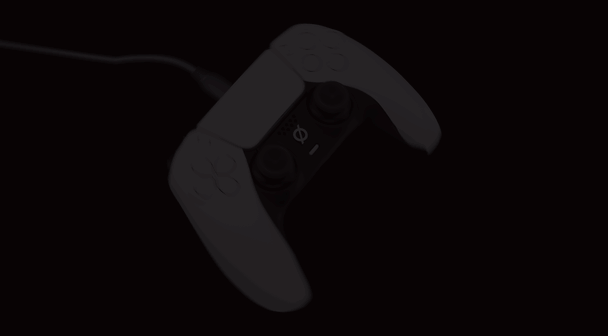
  </picture>
</p>

<h1 align="center">DS5 Untethered</h1>

<p align="center"><strong>DualSense haptics and adaptive triggers over Bluetooth on Windows.</strong><br>Play supported games with their own controller effects, using your PC's Bluetooth.<br>Free and open source.</p>

<p align="center">
  <a href="https://github.com/Midzer00/ds5-untethered/releases/latest"></a>
  <a href="LICENSE"></a>
  
  
  
  <a href="https://github.com/sponsors/Midzer00"></a>
  <a href="https://github.com/Midzer00/ds5-untethered/stargazers"></a>
</p>

<p align="center">
  <a href="https://github.com/Midzer00/ds5-untethered/releases/latest"></a>
  <a href="https://github.com/sponsors/Midzer00"></a>
</p>

<p align="center"><a href="#english">English</a> · <a href="#türkçe">Türkçe</a> · <a href="#quick-start">Quick Start</a> · <a href="#troubleshooting">Troubleshooting</a> · <a href="CHANGELOG.md">Changelog</a> · <a href="https://ds5untethered.com/">Website</a> · <a href="https://drive.google.com/file/d/1dSZgX1E2ETb50e1AbPEG-hCaTthpGGVd/view">Media kit</a></p>

<p align="center">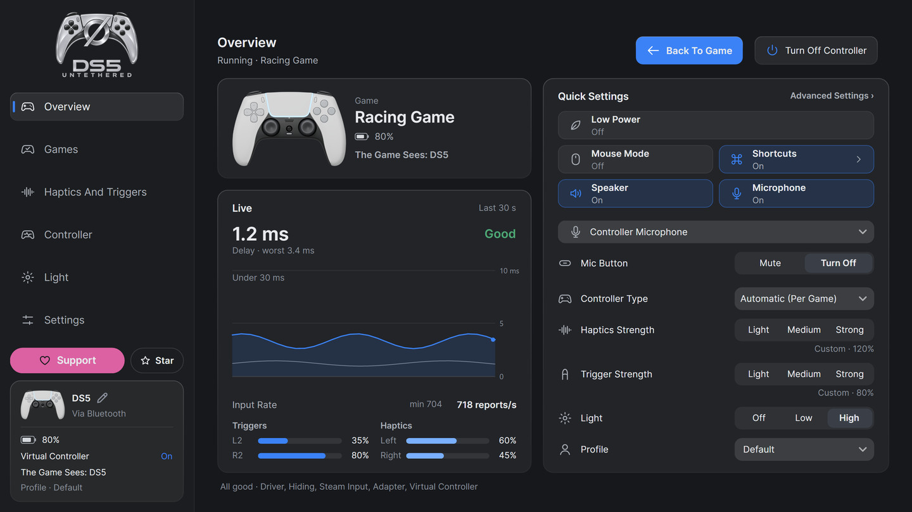</p>

<p align="center"><sub>Unofficial project, not affiliated with Sony. See the <a href="#disclaimer">Disclaimer</a> (<a href="#yasal-uyarı">Yasal uyarı</a>).</sub></p>

## English

### Quick Start

1. Download the installer (`DS5-Untethered-<version>-Setup.exe`) from
   [Releases](https://github.com/Midzer00/ds5-untethered/releases/latest) and run it.
2. Install the two drivers, [usbip-win2](https://github.com/vadimgrn/usbip-win2) and
   [HidHide](https://github.com/nefarius/HidHide). Their installers need administrator rights.
3. Pair the controller with Windows over Bluetooth.
4. Open DS5 Untethered and follow its Setup page: it checks the drivers, guides pairing and tests the Bluetooth adapter.
5. Start a game. It sees a wired DualSense, and its haptics and trigger effects reach the controller over Bluetooth.

Questions? Ask in [Discussions](https://github.com/Midzer00/ds5-untethered/discussions). Website: [ds5untethered.com](https://ds5untethered.com/).

### The problem

On a PC, a DualSense controller's game haptics only work when it is connected with a USB cable, and in most games the
adaptive triggers do too. Over Bluetooth, games see a different device: the detailed haptics fall back to plain rumble,
and most games drop the trigger effects. DS5 Untethered relays them over Bluetooth so that games see a wired controller.

### How it works

DS5 Untethered connects to the controller over Bluetooth and creates a virtual wired DualSense on the same PC through a local
USB/IP server and usbip-win2. Games talk to the virtual controller as if it were plugged in. Input from the real
controller is forwarded to the virtual one; the game's output (adaptive triggers, lights) and its haptics audio are
converted and sent back to the controller over Bluetooth. HidHide hides the real controller from games so they only
see the virtual one.

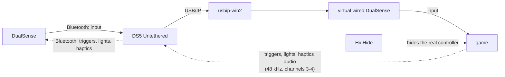

### How to use

- **Profiles.** A profile holds the haptics, trigger and rumble settings. A game can have several named profiles: create
  one with a name from the game's settings (Games page), rename or duplicate it, and switch between them on the Overview
  or in the game's settings. A switch while the game runs applies at once.
- **Quick changes without leaving the game.** Press PS briefly: the app comes to the front and Mouse Mode turns on, so
  the touchpad works as a mouse. Change what you want, then press Back To Game: the game is in front again and Mouse
  Mode turns off.

### Download

The current release is on the repository's [Releases](https://github.com/Midzer00/ds5-untethered/releases) page, as an
installer (`DS5-Untethered-<version>-Setup.exe`, per-user, no administrator rights) and as a zip
(`DS5-Untethered-<version>-win-x64.zip`, unzip anywhere and run `Kopru.App.exe`). Both include .NET; nothing else needs
to be installed for the app itself.

- The build is not signed, so Windows SmartScreen may warn: choose "More info", then "Run anyway".
- On start, until it has been completed once, the Setup page checks for the two drivers, usbip-win2 and HidHide, and
  opens their official download pages (the app does not install them; their installers need administrator rights),
  then guides Bluetooth pairing of the controller. Both drivers are required: the virtual controller does not start
  without them.
- Settings, profiles and logs are stored in `%LOCALAPPDATA%\Untethered`.
- What changed in each version is in [CHANGELOG.md](CHANGELOG.md).
- Network: with "Download Pictures" on (Games page, on by default), the app fetches game header pictures
  from Steam's public CDN (and, for newer games, Steam's public app details) and keeps them only in
  `%LOCALAPPDATA%\Untethered\cache\game-images`. A request names only the game's Steam app id; nothing about you is sent.
  The app also checks GitHub for a new version at start and once a week ("Check For Updates Automatically" in
  Settings > General turns it off); this only requests a file, nothing about you is sent.
- To uninstall: turn off "Start with Windows", exit the app from the tray icon, uninstall "DS5 Untethered" in Windows
  Settings → Apps (or delete the zip folder), and delete `%LOCALAPPDATA%\Untethered` if you want the settings gone.
  If nothing else uses them, uninstall "USBip" and "HidHide" too.

### Questions

#### Do DualSense haptics and adaptive triggers work over Bluetooth on PC?

Not fully by themselves: games send the detailed haptics only to a controller connected with a cable, and most games
send their trigger effects only then too. Over Bluetooth the haptics fall back to plain rumble. With DS5 Untethered
running, games see a wired DualSense, and their haptics and trigger effects reach the controller over Bluetooth.

#### Some of my games already vibrate and use the triggers over Bluetooth. Why would I need this?

Some games send adaptive trigger effects and basic rumble over Bluetooth on their own. The detailed, audio-based
haptics normally go only to a wired controller, so over Bluetooth you get plain rumble. DS5 Untethered makes the game
see a wired controller, so you get the full haptics wirelessly, also in games that offer no DualSense features over
Bluetooth.

#### Do I need a dongle or extra hardware?

No special hardware. The Bluetooth already in your PC or an ordinary USB Bluetooth adapter is enough. The Setup page
tests the adapter.

#### Does it add input lag?

In a 60 second test with one controller and one adapter, input was relayed at about 750 Hz with low added latency and
no loss. The Overview page shows the delay live, so you can check your own setup.

#### Which games does it work with?

Games that support the DualSense's haptics or adaptive triggers over a USB cable. Known ones are listed on the app's
Games page, under Supported. Games without DualSense support can use the Xbox And DS4 Rumble settings or Turn Sound
Into Haptics. Games that use Xbox trigger rumble, racing games especially, can play it on the DualSense triggers with
the experimental Xbox Trigger Rumble setting (off by default).

#### Is it free?

Yes. It is free and open source under GPL-3.0, and there is no paid version.

DS5 Untethered is free and stays free. If it is useful to you, you can support its development on
[GitHub Sponsors](https://github.com/sponsors/Midzer00).

### Troubleshooting

- **The Setup page says usbip-win2 or HidHide is not installed.** Click "Download usbip-win2" or "Download HidHide",
  install it from its official page, then click "Check Again". If the page shows "Restart The Computer", restart so the
  drivers can work.
- **No Bluetooth adapter is found, or Bluetooth is off.** Turn Bluetooth on with "Open Bluetooth Settings". The virtual
  controller can't start without an adapter; the Bluetooth in your PC or an ordinary USB adapter is enough.
- **The Bluetooth Adapter Test says "Borderline" or "Not suitable".** Move the adapter to a front USB 2.0 port or onto a
  short USB extension cable on the desk, away from USB 3.0 (blue) ports and 2.4 GHz receivers. Keep the controller
  within a few metres; if nothing changes, try a Bluetooth 5 or newer adapter.
- **The controller is paired in Windows, but the app shows "Not Connected".** It is off or asleep: press the PS button.
  If the app shows "Not Paired", hold Create and PS until the light blinks, then pair it.
- **The controller is plugged in with a USB cable.** Games already see it as wired, so the app stops the virtual
  controller ("Cable Connected"). Unplug the cable to play wirelessly; the virtual controller starts again by itself
  over Bluetooth.
- **SmartScreen warns when you start the installer.** The build is not signed: choose "More info", then "Run anyway".
- **A game doesn't see the controller after a Controller Type change.** A change made while the game is open applies
  when you restart the game. "Apply Now" switches right away, but the game may lose the controller; then restart the
  game.
- **Reporting a bug.** Settings and profiles are in `%LOCALAPPDATA%\Untethered`, logs in its `logs` folder. Include the
  log when you ask in [Discussions](https://github.com/Midzer00/ds5-untethered/discussions).

### Status

Most features are tested in code only; what was measured on a real controller is listed below.

Done and verified on hardware:
- Bluetooth session: input reading, output reports, haptics stream; Bluetooth adapter check.
- Virtual wired DualSense via usbip-win2: Windows recognizes it as a wired DualSense, input reaches applications,
  game audio arrives.
- Bridge (60 s test): input relayed at about 750 Hz with low added latency and no loss; trigger and light output
  forwarded; game haptics audio converted to Bluetooth haptics reports.
- Bluetooth microphone: Windows records from the controller's microphone, with no ghost input on the virtual
  controller; the controller's mute button turns the microphone on and off.
- Controller speaker: sound played to the controller's speaker is heard by its own microphone.
- Mouse Mode: touchpad pointer, one click per press, Right Click setting (Off by default, Right Side or Two
  Fingers), a short PS press that opens the app also turns it on, and Back To Game.
- In-app updates from this repository's Releases (0.1.8 updated itself to 0.1.9).
- DualShock 4 type: it presents itself like a real wired DualShock 4; verified in one game with native DualShock 4
  support so far.
- Xbox And DS4 Rumble (a game's rumble played as haptics) and Turn Sound Into Haptics: verified in one game without
  native haptics so far (Turn Sound Into Haptics was fixed in 0.1.10).
- Named profiles and per-game profiles, in daily use.

Done and tested in code, not yet verified on hardware:
- Xbox Series controller type, and Xbox Trigger Rumble (experimental, off by default): games that use Xbox trigger
  rumble get an Xbox Series controller, and their trigger rumble plays on the DualSense triggers. On Windows older than
  10 21H2 the app uses Xbox 360 instead.
- Stopping rumble that keeps going after a game closes; fewer microphone dropouts (adaptive buffer, lost-packet
  concealment).
- The app: setup page, Overview, Games, Haptics And Triggers, one Controller page (Test, Output Tests, Remap and
  Gyro), Light, Settings, the icon next to the clock and notifications; the bridge is shown as the "Virtual
  Controller" and starts by itself (stop it in Settings > General or from the menu of its icon next to the clock).
  The controller pictures show the real colour of the controller's light.
- Controller Type per game (DualSense, DualShock 4, Xbox Series or Xbox 360): games with DualSense support get their
  own haptics and triggers straight through; the Xbox And DS4 Rumble settings only apply where the game sends nothing.
  Automatic picks per game: DualSense for games with native DualSense support (the app's list, Steam store data shipped
  with the app, or learned while the game plays), Xbox Series for Xbox trigger rumble games while Xbox Trigger Rumble
  is on, DualShock 4 for games that only support it, otherwise the Default Controller Type, else Xbox 360. It reads Steam's local app info on the PC; nothing about your games is sent.
- Games page: Supported, Xbox Trigger Rumble and Unsupported games found from Steam and Epic, a Play button, a Start File you choose, and
  each game's settings in a pop-up. Games are recognised by exe names from Steam's data, also when installed outside
  Steam folders.
- Hiding the real controller with HidHide; Pause Haptics In Silence; reconnection, battery warning, idle power-off.
- DSX Mod Support (off by default): game mods made for DSX can send trigger and light effects.
- Trigger strength, remapping, gyro aim, light effects.
- Microphone button light and notifications, controller speaker in games.
- DualSense Edge, up to four controllers that are remembered and can be named.

Not done yet:
- Installing the two drivers from the installer, code signing.
- Long gaming sessions and most features above on real hardware.

### Requirements

- Windows 10 or 11
- A Bluetooth adapter
- [usbip-win2](https://github.com/vadimgrn/usbip-win2)
- [HidHide](https://github.com/nefarius/HidHide)

### Building

Requires the .NET 8 SDK. From the repository root (`tools\test.ps1` builds, then runs the test projects in parallel processes; plain `dotnet test` works too, only slower):

```
dotnet build
powershell -ExecutionPolicy Bypass -File tools\test.ps1
```

### Screenshots

| Per-game profiles | Haptics and triggers |
|---|---|
| 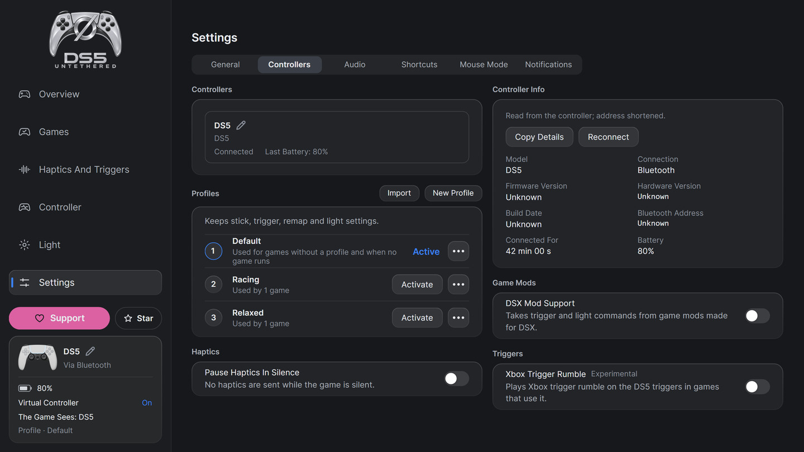 | 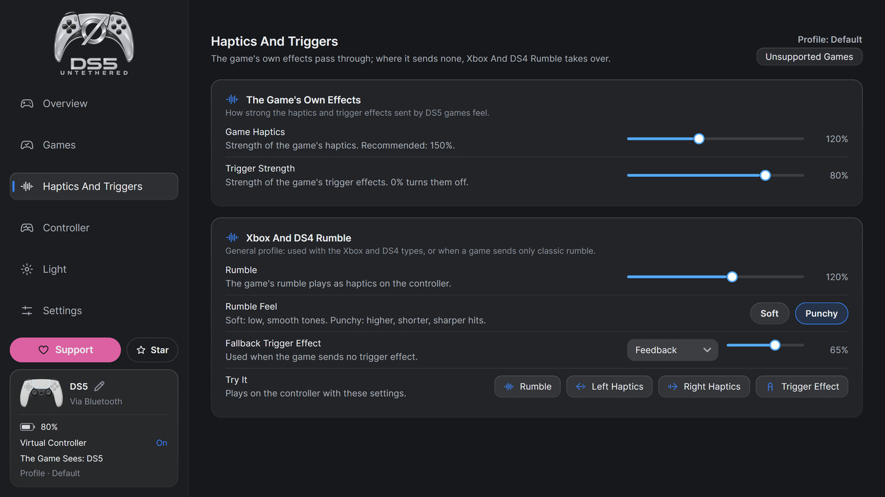 |
| **Gyro aiming** | **Sound into haptics** |
| 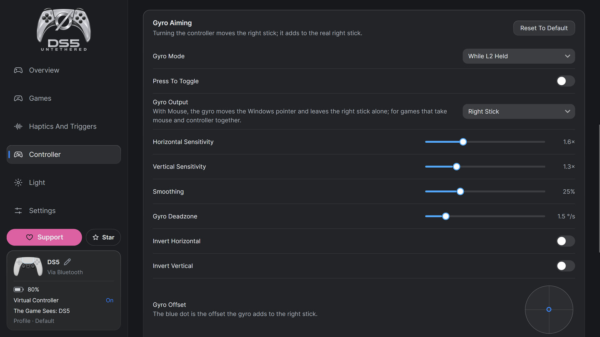 | 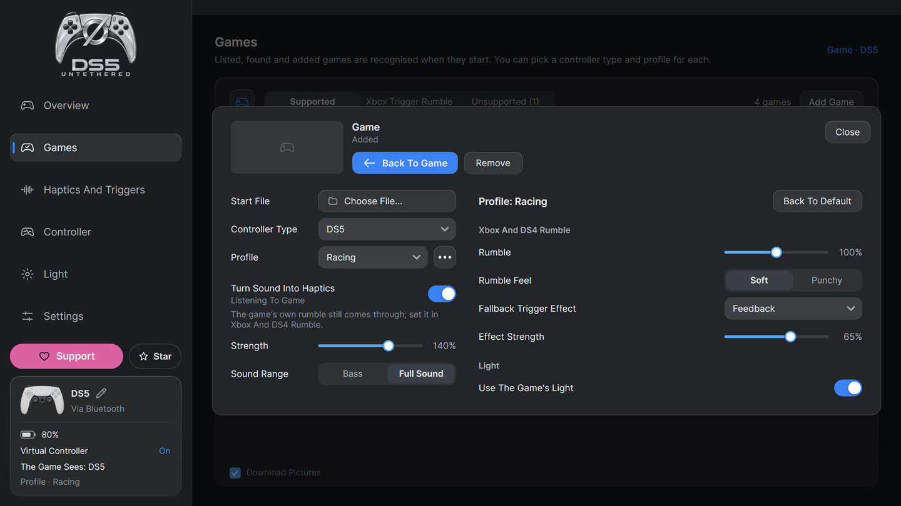 |

Find cover images, screenshots, short videos and a setup guide in the [media kit](https://drive.google.com/file/d/1dSZgX1E2ETb50e1AbPEG-hCaTthpGGVd/view).

### Disclaimer

DS5 Untethered is an unofficial project. It is not affiliated with, endorsed or sponsored by Sony Interactive Entertainment.
"DualSense", "DualSense Edge", "PlayStation" and "PS5" are trademarks of Sony Interactive Entertainment Inc. and are
used only to describe compatibility. "DS5" is used only as a common shorthand to describe compatibility. No Sony firmware, software, images or logos are included. The controller drawings
are original. The protocol implementation is an independent interoperability implementation based on public
documentation and our own measurements. Use at your own risk; the software comes with no warranty.

### License

GPL-3.0-or-later. See [LICENSE](LICENSE) and [THIRD-PARTY-NOTICES.md](THIRD-PARTY-NOTICES.md).

## Türkçe

DS5 Untethered ile PC'de DualSense'in haptik titreşimlerini ve adaptif tetiklerini kablosuz kullanabilirsiniz.
Uygulama, destekleyen oyunların kendi efektlerini Bluetooth üzerinden kumandaya aktarır. Ücretsiz ve açık kaynaklıdır;
bilgisayarınızın Bluetooth'u veya standart bir USB Bluetooth adaptörü yeterlidir.

### Hızlı Başlangıç

1. [Releases](https://github.com/Midzer00/ds5-untethered/releases/latest) sayfasından kurulum dosyasını
   (`DS5-Untethered-<sürüm>-Setup.exe`) indirip çalıştırın.
2. Gerekli iki sürücüyü kurun: [usbip-win2](https://github.com/vadimgrn/usbip-win2) ve
   [HidHide](https://github.com/nefarius/HidHide). Sürücü kurulumu için yönetici izni gerekir.
3. Kumandayı Windows'ta Bluetooth'la eşleştirin.
4. DS5 Untethered'ı açıp kurulum sayfasındaki adımları izleyin: uygulama sürücüleri kontrol eder, eşleştirme adımlarını gösterir ve
   Bluetooth adaptörünü test eder.
5. Oyunu başlatın. Oyun kumandayı kablolu bir DualSense olarak tanır, haptik ve tetik efektleri de Bluetooth'tan kumandaya ulaşır.

Sorularınız için [Discussions](https://github.com/Midzer00/ds5-untethered/discussions) bölümüne yazın. Web sitesi: [ds5untethered.com/tr](https://ds5untethered.com/tr/).

### Neden böyle bir uygulama gerekiyor?

DualSense'i PS5'te kullananlar bilir: haptik titreşimler ve adaptif tetikler oyun deneyiminde önemli bir yer tutuyor.
PC'de ise destekleyen oyunlarda bu özelliklerden tam olarak yararlanmak için çoğunlukla kumandayı USB kablosuyla
bağlamak gerekiyor. Bazı oyunlar Bluetooth üzerinden de basit titreşim veya tetik efekti gönderebilse de ayrıntılı
haptik titreşimler kablolu bağlantıyla sınırlı kalıyor.

DS5 Untethered, oyuna kabloyla bağlı bir DualSense göstererek oyunun bu efektleri göndermesini sağlıyor.
Efektler daha sonra Bluetooth üzerinden elinizdeki kumandaya aktarılıyor.

### Nasıl çalışıyor?

Uygulama, DualSense'e Bluetooth üzerinden bağlanır. Aynı bilgisayarda yerel bir USB/IP sunucusu ve usbip-win2
aracılığıyla sanal bir kablolu DualSense oluşturur. Oyun bu sanal aygıtı gerçek bir kablolu kumanda olarak tanır.

Tuş, analog ve hareket verileri gerçek kumandadan sanal kumandaya aktarılır. Oyunun gönderdiği adaptif tetik,
ışık ve haptik ses verileri de Bluetooth bağlantısına uygun biçime dönüştürülerek gerçek kumandaya iletilir.
HidHide, gerçek kumandayı oyunlardan gizleyerek aynı tuşa iki kez basılmış gibi algılanmasını önler.

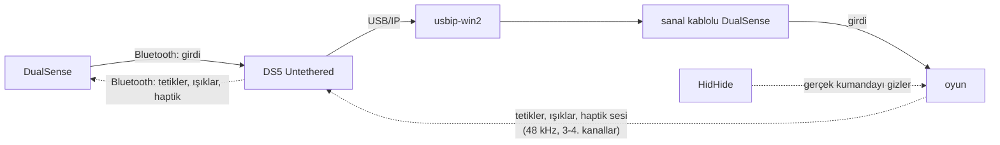

### Kullanım

- **Oyun başına ayarlar ve profiller.** Oyunlar sayfasından bir oyunun ayarlarını açıp farklı adlarla profiller
  oluşturabilir, mevcut profilleri yeniden adlandırabilir veya çoğaltabilirsiniz. Her profil kendi haptik titreşim,
  tetik ve standart titreşim ayarlarını saklar. Genel Bakış'tan veya oyunun ayarlarından profil seçebilirsiniz;
  oyun açıkken profil değiştirdiğinizde yeni ayarlar hemen uygulanır.
- **Kumandayı bırakmadan ayar değiştirme.** Oyundayken PS tuşuna kısa basınca uygulama öne gelir ve Fare Modu açılır.
  Dokunmatik yüzeyi fare olarak kullanıp ayarlarınızı değiştirebilirsiniz. Oyuna Dön'e bastığınızda oyun yeniden
  öne gelir ve Fare Modu kapanır.
- **Xbox oyunlarında tetik titreşimi.** 0.2.0 ile gelen Xbox Series kumanda türü, Xbox'ın Impulse Triggers
  özelliğini kullanan oyunların gönderdiği tetik titreşimini DualSense'in tetik motorlarına aktarır. Özellikle yarış
  oyunlarında gaz, fren, ABS ve patinaj gibi etkiler için kullanılır. Ayarlar > Kumandalar bölümündeki Tetikler
  kartından veya Oyunlar sayfasındaki Xbox Tetik Titreşimi bölümünden açabilirsiniz. Her profilde Xbox Gibi,
  Yumuşak, Keskin veya Kapalı seçilebilir. **Bu özellik deneyseldir ve varsayılan olarak kapalıdır.**
  Otomatik seçim, özellik açıkken ilgili oyunlar için Xbox Series türünü kullanır; yerel DualSense desteği olan
  oyunlarda öncelik yine DualSense'tedir. Xbox Series türü için Windows 10 21H2 veya sonrası gerekir.

### İndirme

Güncel sürümü deponun [Releases](https://github.com/Midzer00/ds5-untethered/releases) sayfasından indirebilirsiniz.
Kurulum dosyası (`DS5-Untethered-<sürüm>-Setup.exe`) uygulamayı yalnızca sizin hesabınıza kurar ve yönetici izni
istemez. ZIP paketini (`DS5-Untethered-<sürüm>-win-x64.zip`) istediğiniz yere açıp `Kopru.App.exe`'yi çalıştırmanız yeterli.
.NET her iki pakete de dahildir; ayrıca .NET kurmanız gerekmez.

- Uygulamada kod imzası bulunmadığından Windows SmartScreen uyarı gösterebilir. "Ek bilgi"ye, ardından "Yine de çalıştır"a
  tıklayın.
- Kurulum sayfası, bir kez tamamlanana kadar uygulama her açıldığında karşınıza çıkar. Önce usbip-win2 ve HidHide'ın
  kurulu olup olmadığını kontrol eder; eksik sürücüler için resmi indirme sayfalarını açar. Sürücüleri kendiniz
  kurmanız gerekir ve bu işlem yönetici izni ister. Ardından Bluetooth eşleştirme adımlarını gösterir. Sanal kumandanın
  çalışması için iki sürücünün de kurulu olması gerekir.
- Ayarlar, profiller ve günlükler `%LOCALAPPDATA%\Untethered` klasöründe saklanır.
- Sürümlerdeki değişiklikleri [CHANGELOG.md](CHANGELOG.md) dosyasında bulabilirsiniz.
- Ağ erişimi: "Oyun Görsellerini İndir" açıkken (Oyunlar sayfasındadır, varsayılan olarak açıktır) uygulama oyun
  görsellerini Steam'in herkese açık CDN'inden (yeni oyunlarda Steam'in herkese açık uygulama bilgilerinden de) indirir
  ve yalnızca `%LOCALAPPDATA%\Untethered\cache\game-images` klasöründe tutar. İsteklerle yalnızca oyunun Steam uygulama
  kimliği gönderilir, kişisel bilgi gönderilmez.
  Uygulama ayrıca açılışta ve haftada bir GitHub'da yeni sürüm olup olmadığını kontrol eder (Ayarlar > Genel'deki "Güncellemeleri
  Otomatik Denetle" ile kapatılır); bu işlem yalnızca güncelleme dosyasını sorgular, kişisel bilgi gönderilmez.
- Kaldırma: "Windows ile Başlat"ı kapatın, saat yanındaki simgeden uygulamadan çıkın, Windows Ayarlar →
  Uygulamalar'dan "DS5 Untethered"ı kaldırın (zip kullandıysanız klasörü silin). Ayarların da silinmesini istiyorsanız
  `%LOCALAPPDATA%\Untethered` klasörünü silin. Başka bir program kullanmıyorsa "USBip" ve "HidHide"ı da kaldırın.

### Sık sorulanlar

#### DualSense'in haptiği ve adaptif tetikleri PC'de Bluetooth'la çalışır mı?

Her oyunda tam olarak çalışmaz. Ayrıntılı haptik titreşimler genellikle USB bağlantısı gerektirir; çoğu oyun
adaptif tetik efektlerini de yalnızca kablolu bağlantıda gönderir. Bluetooth bağlantısında basit titreşimle sınırlı
kalabilirsiniz. DS5 Untethered, oyunun kumandayı kablolu olarak tanımasını sağlayıp gönderilen efektleri Bluetooth
üzerinden kumandaya aktarır.

#### Bazı oyunlarımda Bluetooth'ta zaten titreşim ve tetikler çalışıyor. Buna neden ihtiyacım olsun?

Bazı oyunlar Bluetooth üzerinden adaptif tetik efektleri ve basit titreşim gönderebiliyor. Ayrıntılı haptik
verileri ise genellikle yalnızca USB bağlantısında gönderiliyor. Uygulama bu verileri de kablosuz aktararak
destekleyen oyunların kablolu bağlantıda sunduğu kumanda efektlerini Bluetooth üzerinden kullanmanızı sağlıyor.

#### Özel bir adaptör veya ek donanım gerekiyor mu?

Özel bir donanım gerekmiyor. Bilgisayarınızın dahili Bluetooth'u veya standart bir USB Bluetooth adaptörü yeterli. Kurulum
sayfası adaptörü test ediyor.

#### Gecikme ekliyor mu?

Tek kumanda ve tek adaptörle yapılan 60 saniyelik testte girdi yaklaşık 750 Hz'de, düşük ek gecikmeyle ve kayıpsız
aktarıldı. Genel Bakış sayfası gecikmeyi canlı gösteriyor, kendi kurulumunuzda bakabilirsiniz.

#### Hangi oyunlarda çalışır?

USB bağlantısında DualSense'in haptik titreşimlerini veya adaptif tetiklerini destekleyen oyunlarda. Bilinen oyunlar uygulamadaki
Oyunlar sayfasında, Desteklenen bölümünde listeleniyor. DualSense desteklemeyen oyunlarda Xbox ve DS4 Titreşimi
ayarları ya da Sesi Titreşime Çevir kullanılabilir. Xbox tetik titreşimini destekleyen oyunlarda da deneysel Xbox Tetik Titreşimi
ayarını açarak bu efektleri DualSense'in tetiklerinde kullanabilirsiniz. Bu seçenek varsayılan olarak kapalıdır.

#### Ücretli mi?

Hayır. Ücretsiz ve açık kaynak (GPL-3.0), ücretli sürümü yok.

DS5 Untethered ücretsiz ve açık kaynaklı kalacak. İşinize yaradıysa
[GitHub'da yıldız vererek](https://github.com/Midzer00/ds5-untethered) projeyi destekleyebilirsiniz.
Maddi destek olmak isteyenler için [GitHub Sponsors](https://github.com/sponsors/Midzer00) da açık.
Hata bildirimleri, öneriler ve kod katkıları da projenin gelişmesine yardımcı oluyor.

### Sorun Giderme

- **Kurulum sayfası usbip-win2 ya da HidHide kurulu değil diyor.** "usbip-win2'yi İndir" ya da "HidHide'ı İndir"e
  tıklayıp sürücüyü resmi sayfasından kurun, sonra "Yeniden Kontrol Et"e basın. Sayfada "Bilgisayarı Yeniden Başlat"
  çıkarsa sürücülerin çalışması için bilgisayarı yeniden başlatın.
- **Bluetooth adaptörü bulunamadı ya da Bluetooth kapalı.** "Bluetooth Ayarlarını Aç" ile Bluetooth'u açın. Sanal
  kumanda adaptör olmadan başlamaz; bilgisayarın kendi Bluetooth'u ya da sıradan bir USB adaptör yeter.
- **Bluetooth Adaptör Testi "Sınırda" ya da "Uygun değil" diyor.** Adaptörü öndeki bir USB 2.0 girişine ya da kısa bir
  USB uzatma kablosuyla masanın üstüne alın; USB 3.0 (mavi) girişlerden ve 2,4 GHz alıcılardan uzak tutun. Kumandayı
  birkaç metre içinde tutun; sonuç değişmezse Bluetooth 5 ya da daha yeni bir adaptör deneyin.
- **Kumanda Windows'ta eşleşmiş ama uygulama "Bağlı Değil" gösteriyor.** Kumanda kapalı ya da uykuda: PS tuşuna basın.
  Uygulama "Eşleşmemiş" gösteriyorsa Create ve PS tuşlarını ışık yanıp sönene kadar basılı tutup eşleştirin.
- **Kumanda USB kablosuyla takılı.** Oyunlar onu zaten kablolu gördüğü için uygulama sanal kumandayı durdurur ("Kablo
  Bağlandı"). Kablosuz oynamak için kabloyu çıkarın; sanal kumanda Bluetooth'ta kendiliğinden yeniden başlar.
- **Kurulum dosyasını açarken SmartScreen uyarı veriyor.** Uygulamada kod imzası yok: "Ek bilgi"ye, ardından "Yine de
  çalıştır"a tıklayın.
- **Kumanda Türü değişince oyun kumandayı görmüyor.** Oyun açıkken yapılan değişiklik, oyunu yeniden başlatınca geçerli
  olur. "Şimdi Uygula" değişikliği hemen uygular. Oyun kumandayı algılamayı bırakırsa oyunu yeniden başlatın.
- **Hata bildirirken.** Ayarlar ve profiller `%LOCALAPPDATA%\Untethered` klasöründe, günlükler de içindeki `logs`
  klasöründe saklanır. [Discussions](https://github.com/Midzer00/ds5-untethered/discussions) bölümüne yazarken günlüğü
  ekleyin.

### Geliştirme ve test durumu

Özelliklerin çoğu şimdilik yalnızca kod testlerinden geçti.

Gerçek kumandayla doğrulananlar:
- Bluetooth oturumu: girdi okuma, çıktı raporları, haptik akışı; Bluetooth adaptör testi.
- usbip-win2 ile sanal kablolu DualSense: Windows kablolu DualSense olarak tanıyor, girdi uygulamalara ulaşıyor,
  oyun sesi geliyor.
- Köprü (60 saniyelik test): girdi yaklaşık 750 Hz'de, az ek gecikmeyle ve kayıpsız aktarıldı. Tetik ve ışık çıktısı
  iletildi, oyunun haptik sesi de Bluetooth haptik raporlarına dönüştürüldü.
- Bluetooth'ta mikrofon: Windows kumandanın mikrofonundan kayıt alıyor, sanal kumandada hayalet girdi oluşmuyor.
  Kumandadaki mikrofon tuşu mikrofonu açıp kapatıyor.
- Kumanda hoparlörü: kumandanın hoparlöründen çalınan sesi kumandanın kendi mikrofonu duyuyor.
- Fare Modu: dokunmatik yüzeyle imleç, her basışa tek tık, Sağ Tık ayarı (varsayılan Kapalı, Sağ Taraf ya da İki
  Parmak), uygulamayı açan kısa PS basışıyla açılması ve Oyuna Dön düğmesi.
- Bu deponun Releases sayfasından uygulama içi güncelleme (0.1.8 kendini 0.1.9'a güncelledi).
- DualShock 4 türü: kendini gerçek bir kablolu DualShock 4 gibi tanıtıyor; şimdilik DualShock 4'ü doğrudan destekleyen
  bir oyunda doğrulandı.
- Xbox ve DS4 Titreşimi (oyunun standart titreşiminin haptik titreşime dönüştürülmesi) ve Sesi Titreşime Çevir: şimdilik kendi haptiği
  olmayan bir oyunda doğrulandı (Sesi Titreşime Çevir 0.1.10'da düzeltildi).
- İsim verilebilen profiller ve oyun başına profiller, günlük kullanımda.

Otomatik testleri tamamlanan, donanım doğrulaması bekleyenler:
- Xbox Series kumanda türü ve Xbox Tetik Titreşimi (deneysel, varsayılan olarak kapalı): Xbox tetik titreşimi kullanan
  oyunlara sanal bir Xbox Series kumandası gösterilir;
  oyunun gönderdiği tetik titreşimi DualSense'in tetik motorlarına aktarılır. Windows 10 21H2'den eski
  sürümlerde bunun yerine Xbox 360 türü kullanılır.
- Oyun kapandıktan sonra süren titreşimin durdurulması; mikrofonun daha az kesilmesi (bağlantıya göre ayarlanan ses tamponu ve kayıp
  ses paketlerinin telafi edilmesi).
- Uygulama: kurulum sayfası, Genel Bakış, Oyunlar, Titreşim ve Tetikler, tek bir Kumanda sayfası (Test, Çıkış
  Testleri, Tuş Atama ve Gyro), Işık, Ayarlar, saat yanındaki simge ve bildirimler. Köprü arayüzde "Sanal Kumanda"
  adıyla görünür ve kendiliğinden başlar (Ayarlar > Genel'den ya da saat yanındaki simgenin menüsünden durdurulur).
  Kumanda görselleri kumandanın ışığını gerçek rengiyle gösterir.
- Oyun başına Kumanda Türü (DualSense, DualShock 4, Xbox Series ya da Xbox 360): DualSense destekleyen oyunların kendi
  haptik titreşimleri ve tetik efektleri doğrudan aktarılır; Xbox ve DS4 Titreşimi ayarları yalnızca oyunun hiçbir şey göndermediği yerde
  devreye girer. Otomatik oyuna göre seçer: DualSense'i doğrudan destekleyen oyunlara DualSense (uygulamanın listesi,
  uygulamayla gelen Steam mağaza bilgisi ya da oyun oynanırken öğrenilir), Xbox Tetik Titreşimi açıkken Xbox tetik
  titreşimi olan oyunlara Xbox Series, yalnızca DualShock 4'ü destekleyenlere
  DualShock 4, diğerlerine Varsayılan Kumanda Türü, o da yoksa Xbox 360. Steam'in bilgisayardaki uygulama bilgilerini
  okur; oyunlarınızla ilgili hiçbir bilgi gönderilmez.
- Oyunlar sayfası: Steam ve Epic'ten bulunan Desteklenen, Xbox Tetik Titreşimi ve Desteklenmeyen oyunlar, Oyna düğmesi, seçilebilen
  Başlatma Dosyası ve açılır pencerede her oyunun kendi ayarları. Oyunlar Steam verisindeki exe adlarından, Steam
  klasörleri dışına kuruluysa da tanınır.
- Gerçek kumandanın HidHide ile gizlenmesi; Sessizlikte Haptiği Durdur; yeniden bağlanma, pil uyarısı, boştayken kapanma.
- DSX Mod Desteği (varsayılan olarak kapalı): DSX için yapılmış oyun modları tetik ve ışık efektlerini gönderebilir.
- Tetik gücü, tuş atama, gyro ile nişan alma, ışık efektleri.
- Mikrofon tuşunun ışığı ve bildirimleri, oyunlarda kumanda hoparlörü.
- DualSense Edge; en fazla dört kumanda; uygulama kumandaları hatırlar ve her birine isim verilebilir.

Henüz yapılmadı:
- İki sürücünün kurulum programından kurulması, kod imzalama.
- Uzun oyun oturumları; yukarıdaki özelliklerin çoğunun gerçek donanımda denenmesi.

### Gereksinimler

- Windows 10 veya 11
- Bluetooth adaptörü
- [usbip-win2](https://github.com/vadimgrn/usbip-win2)
- [HidHide](https://github.com/nefarius/HidHide)

### Derleme

.NET 8 SDK gerekir. Deponun kök klasöründe şunları çalıştırın (`tools\test.ps1` derler, sonra test projelerini paralel süreçlerde çalıştırır; düz `dotnet test` de çalışır, yalnızca daha yavaştır):

```
dotnet build
powershell -ExecutionPolicy Bypass -File tools\test.ps1
```

### Ekran görüntüleri

<p align="center">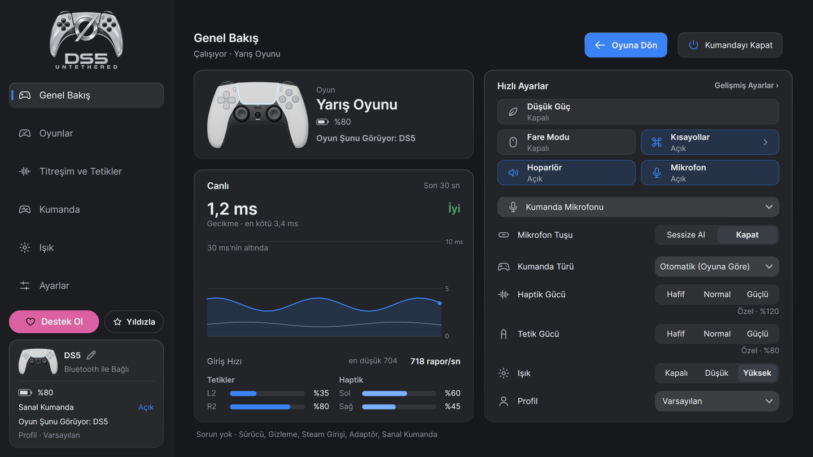</p>

| Oyuna özel profiller | Titreşim ve tetikler |
|---|---|
| 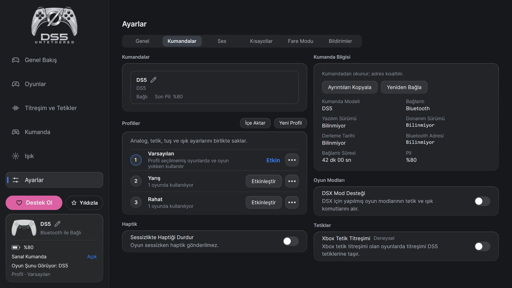 | 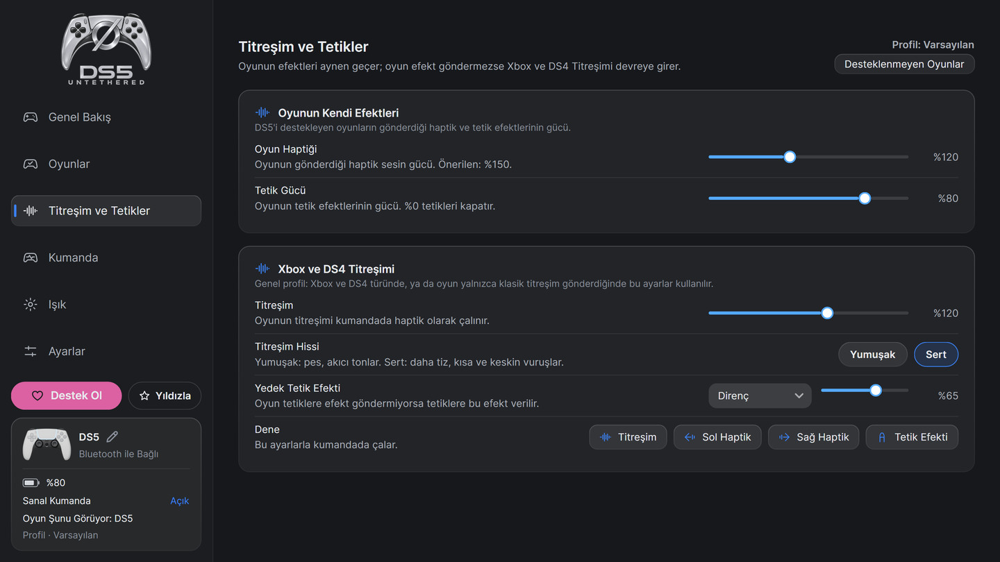 |
| **Gyro ile nişan alma** | **Sesi titreşime çevir** |
| 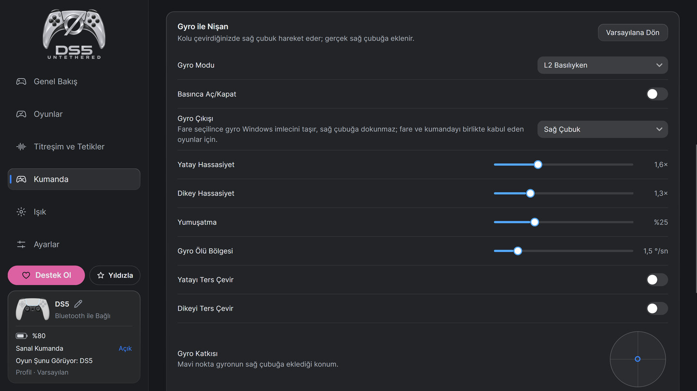 |  |

Kapak görsellerini, ekran görüntülerini, kısa tanıtım videolarını ve Türkçe kurulum kılavuzunu [medya kitinde](https://drive.google.com/file/d/1dSZgX1E2ETb50e1AbPEG-hCaTthpGGVd/view) bulabilirsiniz.

### Yasal uyarı

DS5 Untethered resmi bir proje değildir. Sony Interactive Entertainment ile bağlantısı yoktur, şirketin onayını
ya da desteğini de almamıştır. "DualSense", "DualSense Edge", "PlayStation" ve "PS5",
Sony Interactive Entertainment Inc.'in ticari markalarıdır ve burada yalnızca uyumluluğu belirtmek için kullanılmıştır.
"DS5" de yalnızca uyumluluğu belirtmek için, yaygın bir kısaltma olarak kullanılmıştır. Projede Sony'ye ait hiçbir
donanım yazılımı, yazılım, görsel veya logo bulunmaz. Kumanda çizimleri özgündür. Protokol, herkese açık belgelere ve
kendi ölçümlerimize dayanılarak, birlikte çalışabilirlik amacıyla bağımsız olarak uygulanmıştır. Yazılımın herhangi
bir garantisi yoktur. Kullanımdan doğabilecek her türlü sorumluluk size aittir.

### Lisans

GPL-3.0-or-later. Ayrıntılar [LICENSE](LICENSE) ve [THIRD-PARTY-NOTICES.md](THIRD-PARTY-NOTICES.md) dosyalarındadır.
