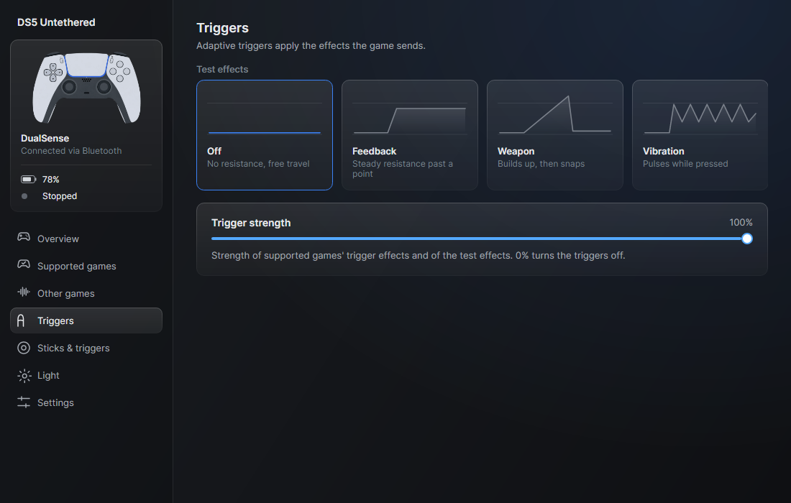
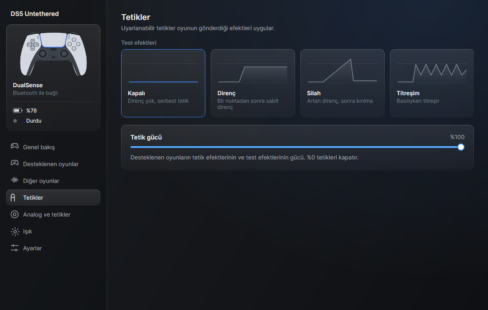

<p align="center"></p>

# DS5 Untethered

For DualSense — the game's own haptics and adaptive triggers over Bluetooth.

[English](#english) | [Türkçe](#türkçe)

## Disclaimer

DS5 Untethered is an unofficial project. It is not affiliated with, endorsed or sponsored by Sony Interactive Entertainment.
"DualSense", "DualSense Edge", "PlayStation" and "PS5" are trademarks of Sony Interactive Entertainment Inc. and are
used only to describe compatibility. "DS5" is used only as a common shorthand to describe compatibility. No Sony firmware, software, images or logos are included. The controller drawings
are original. The protocol implementation is an independent interoperability implementation based on public
documentation and our own measurements. Use at your own risk; the software comes with no warranty.

## English

### The problem

On a PC, a DualSense controller's game haptics and adaptive triggers only work when it is connected with a USB cable.
Over Bluetooth, games see a different device and these features are lost. DS5 Untethered relays them over Bluetooth so that
games see a wired controller.

### How it works

DS5 Untethered connects to the controller over Bluetooth and creates a virtual wired DualSense on the same PC through a local
USB/IP server and usbip-win2. Games talk to the virtual controller as if it were plugged in. Input from the real
controller is forwarded to the virtual one; the game's output (adaptive triggers, lights) and its haptics audio are
converted and sent back to the controller over Bluetooth. HidHide hides the real controller from games so they only
see the virtual one.

```
DualSense --Bluetooth--> DS5 Untethered --USB/IP--> usbip-win2 --> virtual wired DualSense --> game
game --> triggers, lights, haptics audio (48 kHz, channels 3-4) --> DS5 Untethered --Bluetooth--> DualSense
```

### Status

Work in progress. There is no installer and no release yet.

Done and verified on hardware:
- Bluetooth session: input reading, output reports, haptics stream; Bluetooth adapter check.
- Virtual wired DualSense via usbip-win2: Windows recognizes it as a wired DualSense, input reaches applications,
  game audio arrives.
- Bridge (60 s test): input relayed at about 750 Hz with low added latency and no loss; trigger and light output
  forwarded; game haptics audio converted to Bluetooth haptics reports.

Done and tested in code, not yet verified on hardware:
- Hiding the real controller with HidHide.
- Rumble to haptics conversion for games without native haptics.
- Bridge service with reconnection and battery warning.
- First-run setup checks and wizard model (no UI yet).

Not done yet:
- The user interface (Avalonia) exists but runs on a demo service; it is not yet wired to the bridge.
- Isochronous audio stream handling, saving settings, start with Windows, diagnostics export, idle shutdown,
  trigger strength setting, single-file installer.

### Requirements

- Windows 10 or 11
- A Bluetooth adapter
- [usbip-win2](https://github.com/vadimgrn/usbip-win2)
- [HidHide](https://github.com/nefarius/HidHide)

### Building

Requires the .NET 8 SDK. From the repository root:

```
dotnet build
dotnet test
```

### Screenshots

| | |
|---|---|
|  |  |
|  |  |
|  |  |

### License

GPL-3.0-or-later. See [LICENSE](LICENSE) and [THIRD-PARTY-NOTICES.md](THIRD-PARTY-NOTICES.md).

## Türkçe

DualSense için — oyunun kendi haptikleri ve adaptif tetikleri Bluetooth üzerinden.

### Feragat

DS5 Untethered resmi olmayan bir projedir. Sony Interactive Entertainment ile bağlantılı değildir, onun tarafından
onaylanmamış veya desteklenmemiştir. "DualSense", "DualSense Edge", "PlayStation" ve "PS5", Sony Interactive
Entertainment Inc.'in ticari markalarıdır ve yalnızca uyumluluğu belirtmek için kullanılır. "DS5" yalnızca uyumluluğu belirtmek için yaygın bir kısaltma olarak kullanılır. Sony'ye ait hiçbir
yazılım, donanım yazılımı, görsel veya logo içerilmez. Kumanda çizimleri özgündür. Protokol uygulaması, herkese açık
belgelere ve kendi ölçümlerimize dayanan bağımsız bir birlikte çalışabilirlik uygulamasıdır. Kullanım riski size
aittir; yazılım hiçbir garanti olmadan sunulur.

### Sorun

PC'de DualSense kumandanın oyun haptiği ve adaptif tetikleri yalnızca USB kabloyla bağlıyken çalışır. Bluetooth'ta
oyunlar farklı bir cihaz görür ve bu özellikler kaybolur. DS5 Untethered bunları Bluetooth üzerinden aktarır; oyunlar kablolu
bir kumanda görür.

### Nasıl çalışır

DS5 Untethered kumandaya Bluetooth ile bağlanır ve aynı bilgisayarda yerel bir USB/IP sunucusu ile usbip-win2 aracılığıyla
sanal bir kablolu DualSense oluşturur. Oyunlar sanal kumandayla takılıymış gibi konuşur. Gerçek kumandanın girdisi
sanal kumandaya aktarılır; oyunun çıktısı (adaptif tetikler, ışıklar) ve haptik sesi dönüştürülüp Bluetooth ile
kumandaya gönderilir. HidHide gerçek kumandayı oyunlardan gizler, böylece oyunlar yalnızca sanal kumandayı görür.

```
DualSense --Bluetooth--> DS5 Untethered --USB/IP--> usbip-win2 --> sanal kablolu DualSense --> oyun
oyun --> tetikler, ışıklar, haptik sesi (48 kHz, 3-4. kanallar) --> DS5 Untethered --Bluetooth--> DualSense
```

### Durum

Geliştirme sürüyor. Henüz kurulum paketi ve sürüm yok.

Bitti ve donanımda doğrulandı:
- Bluetooth oturumu: girdi okuma, çıkış raporları, haptik akışı; Bluetooth adaptör testi.
- usbip-win2 ile sanal kablolu DualSense: Windows kablolu DualSense olarak tanıyor, girdi uygulamalara ulaşıyor,
  oyun sesi geliyor.
- DS5 Untethered (60 sn test): girdi yaklaşık 750 Hz'de, düşük ek gecikmeyle ve kayıpsız aktarıldı; tetik ve ışık çıktısı
  iletildi; oyun haptik sesi Bluetooth haptik raporlarına dönüştürüldü.

Kodda bitti ve testli, donanımda henüz doğrulanmadı:
- Gerçek kumandayı HidHide ile gizleme.
- Yerel haptik desteği olmayan oyunlar için titreşimden haptiğe dönüşüm.
- Yeniden bağlanma ve pil uyarısı olan köprü servisi.
- İlk kurulum kontrolleri ve sihirbaz modeli (arayüzü henüz yok).

Henüz yapılmadı:
- Arayüz (Avalonia) var ama demo servisle çalışıyor; köprüye henüz bağlı değil.
- İzokron ses akışı, ayarların saklanması, Windows ile başlatma, tanılama dışa aktarma, hareketsizlikte kapanma,
  tetik gücü ayarı, tek dosyalık kurulum paketi.

### Gereksinimler

- Windows 10 veya 11
- Bluetooth adaptörü
- [usbip-win2](https://github.com/vadimgrn/usbip-win2)
- [HidHide](https://github.com/nefarius/HidHide)

### Derleme

.NET 8 SDK gerekir. Depo kök dizininde:

```
dotnet build
dotnet test
```

### Ekran görüntüleri

| | |
|---|---|
|  |  |
|  |  |
|  |  |

### Lisans

GPL-3.0-or-later. Bkz. [LICENSE](LICENSE) ve [THIRD-PARTY-NOTICES.md](THIRD-PARTY-NOTICES.md).
