<p align="center">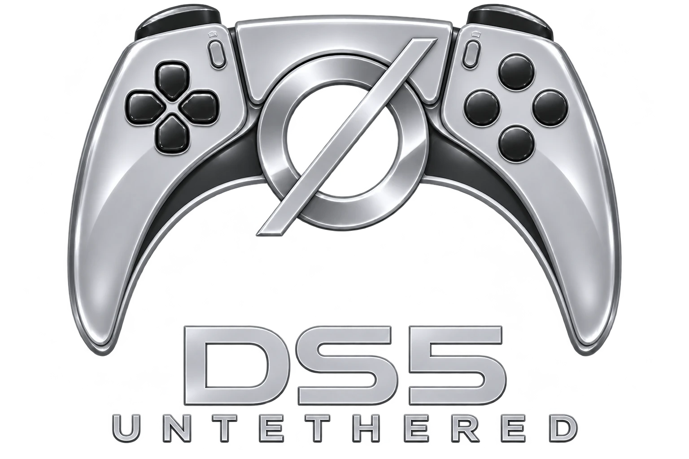</p>

<h1 align="center">DS5 Untethered</h1>

<p align="center">For DualSense — the game's own haptics and adaptive triggers over Bluetooth.</p>

<p align="center">DS5 Untethered lets you play wirelessly on a Windows PC with the DualSense's haptic feedback and adaptive triggers.<br>Free and open source. No USB cable, no special dongle.</p>

<p align="center">
  <a href="https://github.com/Midzer00/ds5-untethered/releases/latest"></a>
  <a href="LICENSE"></a>
  
  
  
  <a href="https://github.com/sponsors/Midzer00"></a>
  <a href="https://github.com/Midzer00/ds5-untethered/stargazers"></a>
</p>

<p align="center">
  <a href="https://github.com/Midzer00/ds5-untethered/releases/latest"></a>
  <a href="https://github.com/sponsors/Midzer00"></a>
</p>

<p align="center">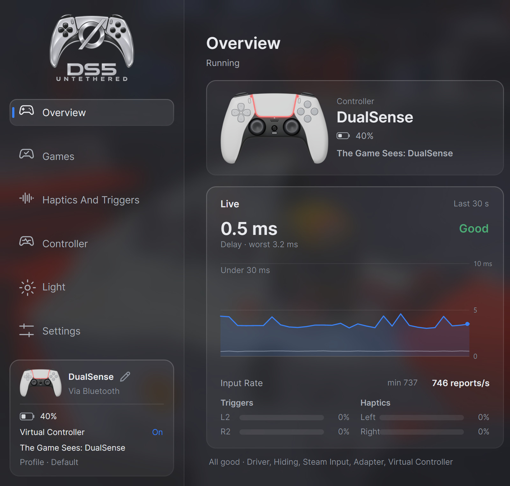</p>

<p align="center"><a href="#english">English</a> · <a href="#türkçe">Türkçe</a> · <a href="#quick-start">Quick Start</a> · <a href="#troubleshooting">Troubleshooting</a> · <a href="CHANGELOG.md">Changelog</a> · <a href="https://midzer00.github.io/ds5-untethered/">Website</a></p>

<p align="center"><sub>Unofficial project, not affiliated with Sony. See the <a href="#disclaimer">Disclaimer</a> (<a href="#yasal-uyarı">Yasal uyarı</a>).</sub></p>

## English

### Quick Start

1. Download the installer (`DS5-Untethered-<version>-Setup.exe`) from
   [Releases](https://github.com/Midzer00/ds5-untethered/releases/latest) and run it.
2. Install the two drivers, [usbip-win2](https://github.com/vadimgrn/usbip-win2) and
   [HidHide](https://github.com/nefarius/HidHide). Their installers need administrator rights.
3. Pair the controller with Windows over Bluetooth.
4. Open DS5 Untethered and follow its Setup page: it checks the drivers, guides pairing and tests the Bluetooth adapter.
5. Start a game. It sees a wired DualSense, and its haptics and trigger effects reach the controller over Bluetooth.

Questions? Ask in [Discussions](https://github.com/Midzer00/ds5-untethered/discussions). Website: [midzer00.github.io/ds5-untethered](https://midzer00.github.io/ds5-untethered/).

### The problem

On a PC, a DualSense controller's game haptics and adaptive triggers only work when it is connected with a USB cable.
Over Bluetooth, games see a different device and these features are lost. DS5 Untethered relays them over Bluetooth so that
games see a wired controller.

### How it works

DS5 Untethered connects to the controller over Bluetooth and creates a virtual wired DualSense on the same PC through a local
USB/IP server and usbip-win2. Games talk to the virtual controller as if it were plugged in. Input from the real
controller is forwarded to the virtual one; the game's output (adaptive triggers, lights) and its haptics audio are
converted and sent back to the controller over Bluetooth. HidHide hides the real controller from games so they only
see the virtual one.

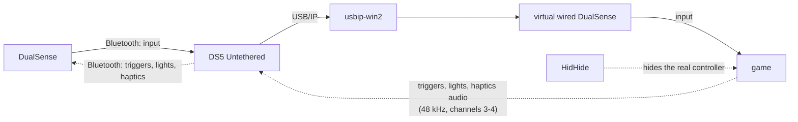

### Download

The current release is on the repository's [Releases](https://github.com/Midzer00/ds5-untethered/releases) page, as an
installer (`DS5-Untethered-<version>-Setup.exe`, per-user, no administrator rights) and as a zip
(`DS5-Untethered-<version>-win-x64.zip`, unzip anywhere and run `Kopru.App.exe`). Both include .NET; nothing else needs
to be installed for the app itself.

- The build is not signed, so Windows SmartScreen may warn: choose "More info", then "Run anyway".
- On start, until it has been completed once, the Setup page checks for the two drivers, usbip-win2 and HidHide, and
  opens their official download pages (the app does not install them; their installers need administrator rights),
  then guides Bluetooth pairing of the controller. Both drivers are required: the virtual controller does not start
  without them.
- Settings, profiles and logs are stored in `%LOCALAPPDATA%\Untethered`.
- What changed in each version is in [CHANGELOG.md](CHANGELOG.md).
- Network: with "Download Pictures" on (Games page, on by default), the app fetches game header pictures
  from Steam's public CDN (and, for newer games, Steam's public app details) and keeps them only in
  `%LOCALAPPDATA%\Untethered\cache\game-images`. A request names only the game's Steam app id; nothing about you is sent.
  The app also checks GitHub for a new version at start and once a week ("Check For Updates Automatically" in
  Settings > General turns it off); this only requests a file, nothing about you is sent.
- To uninstall: turn off "Start with Windows", exit the app from the tray icon, uninstall "DS5 Untethered" in Windows
  Settings → Apps (or delete the zip folder), and delete `%LOCALAPPDATA%\Untethered` if you want the settings gone.
  If nothing else uses them, uninstall "USBip" and "HidHide" too.

### Questions

#### Do DualSense haptics and adaptive triggers work over Bluetooth on PC?

Not by themselves: games only send them to a controller connected with a cable. With DS5 Untethered running, games
see a wired DualSense, and their haptics and trigger effects reach the controller over Bluetooth.

#### Do I need a dongle or extra hardware?

No special hardware. The Bluetooth already in your PC or an ordinary USB Bluetooth adapter is enough. The Setup page
tests the adapter.

#### Does it add input lag?

In a 60 second test with one controller and one adapter, input was relayed at about 750 Hz with low added latency and
no loss. The Overview page shows the delay live, so you can check your own setup.

#### Which games does it work with?

Games that support the DualSense's haptics or adaptive triggers over a USB cable. Known ones are listed on the app's
Games page, under Supported. Games without DualSense support can use the Xbox And DS4 Rumble settings or Turn Sound
Into Haptics.

#### Is it free?

Yes. It is free and open source under GPL-3.0, and there is no paid version.

DS5 Untethered is free and stays free. If it is useful to you, you can support its development on
[GitHub Sponsors](https://github.com/sponsors/Midzer00).

### Troubleshooting

- **The Setup page says usbip-win2 or HidHide is not installed.** Click "Download usbip-win2" or "Download HidHide",
  install it from its official page, then click "Check Again". If the page shows "Restart The Computer", restart so the
  drivers can work.
- **No Bluetooth adapter is found, or Bluetooth is off.** Turn Bluetooth on with "Open Bluetooth Settings". The virtual
  controller can't start without an adapter; the Bluetooth in your PC or an ordinary USB adapter is enough.
- **The Bluetooth Adapter Test says "Borderline" or "Not suitable".** Move the adapter to a front USB 2.0 port or onto a
  short USB extension cable on the desk, away from USB 3.0 (blue) ports and 2.4 GHz receivers. Keep the controller
  within a few metres; if nothing changes, try a Bluetooth 5 or newer adapter.
- **The controller is paired in Windows, but the app shows "Not Connected".** It is off or asleep: press the PS button.
  If the app shows "Not Paired", hold Create and PS until the light blinks, then pair it.
- **The controller is plugged in with a USB cable.** Games already see it as wired, so the app stops the virtual
  controller ("Cable Connected"). Unplug the cable to play wirelessly; the virtual controller starts again by itself
  over Bluetooth.
- **SmartScreen warns when you start the installer.** The build is not signed: choose "More info", then "Run anyway".
- **A game doesn't see the controller after a Controller Type change.** A change made while the game is open applies
  when you restart the game. "Apply Now" switches right away, but the game may lose the controller; then restart the
  game.
- **Reporting a bug.** Settings and profiles are in `%LOCALAPPDATA%\Untethered`, logs in its `logs` folder. Include the
  log when you ask in [Discussions](https://github.com/Midzer00/ds5-untethered/discussions).

### Status

Most features are tested in code only; what was measured on a real controller is listed below.

Done and verified on hardware:
- Bluetooth session: input reading, output reports, haptics stream; Bluetooth adapter check.
- Virtual wired DualSense via usbip-win2: Windows recognizes it as a wired DualSense, input reaches applications,
  game audio arrives.
- Bridge (60 s test): input relayed at about 750 Hz with low added latency and no loss; trigger and light output
  forwarded; game haptics audio converted to Bluetooth haptics reports.
- Bluetooth microphone: Windows records from the controller's microphone, with no ghost input on the virtual
  controller; the controller's mute button turns the microphone on and off.
- Controller speaker: sound played to the controller's speaker is heard by its own microphone.
- Mouse Mode: touchpad pointer, one click per press, Right Click setting (Off by default, Right Side or Two
  Fingers), a short PS press that opens the app also turns it on, and Back To Game.
- In-app updates from this repository's Releases (0.1.8 updated itself to 0.1.9).
- DualShock 4 type: it presents itself like a real wired DualShock 4; verified in one game with native DualShock 4
  support so far.

Done and tested in code, not yet verified on hardware:
- The app: setup page, Overview, Games, Haptics And Triggers, one Controller page (Test, Output Tests, Remap and
  Gyro), Light, Settings, the icon next to the clock and notifications; the bridge is shown as the "Virtual
  Controller" and starts by itself (stop it in Settings > General or from the menu of its icon next to the clock).
  The controller pictures show the real colour of the controller's light.
- Controller Type per game (DualSense, DualShock 4 or Xbox 360): games with DualSense support get their own haptics
  and triggers straight through; the Xbox And DS4 Rumble settings only apply where the game sends nothing.
  Automatic picks per game: DualSense for games with native DualSense support (the app's list, Steam store data shipped
  with the app, or learned while the game plays), DualShock 4 for games that only support it, otherwise the Default
  Controller Type, else Xbox 360. It reads Steam's local app info on the PC; nothing about your games is sent.
- Games page: Supported and Unsupported games found from Steam and Epic, a Play button, a Start File you choose, and
  each game's settings in a pop-up. Games are recognised by exe names from Steam's data, also when installed outside
  Steam folders.
- Hiding the real controller with HidHide; rumble to haptics and Turn Sound Into Haptics for games without native
  haptics; Pause Haptics In Silence; reconnection, battery warning, idle power-off.
- DSX Mod Support (off by default): game mods made for DSX can send trigger and light effects.
- Trigger strength, remapping, gyro aim, light effects.
- Microphone button light and notifications, controller speaker in games.
- DualSense Edge, up to four controllers that are remembered and can be named.

Not done yet:
- Installing the two drivers from the installer, code signing.
- Long gaming sessions and most features above on real hardware.

### Requirements

- Windows 10 or 11
- A Bluetooth adapter
- [usbip-win2](https://github.com/vadimgrn/usbip-win2)
- [HidHide](https://github.com/nefarius/HidHide)

### Building

Requires the .NET 8 SDK. From the repository root (`tools\test.ps1` builds, then runs the test projects in parallel processes; plain `dotnet test` works too, only slower):

```
dotnet build
powershell -ExecutionPolicy Bypass -File tools\test.ps1
```

### Screenshots

| | |
|---|---|
|  | 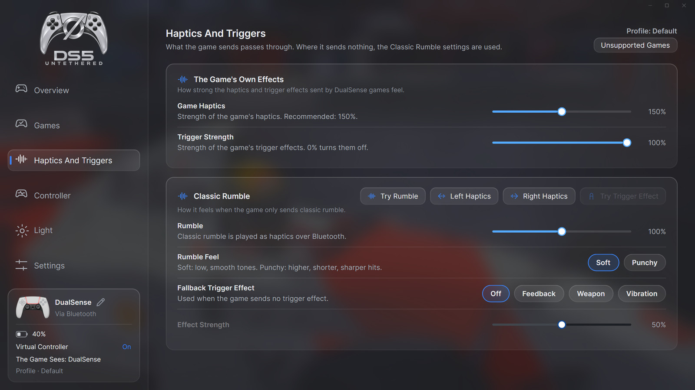 |
| 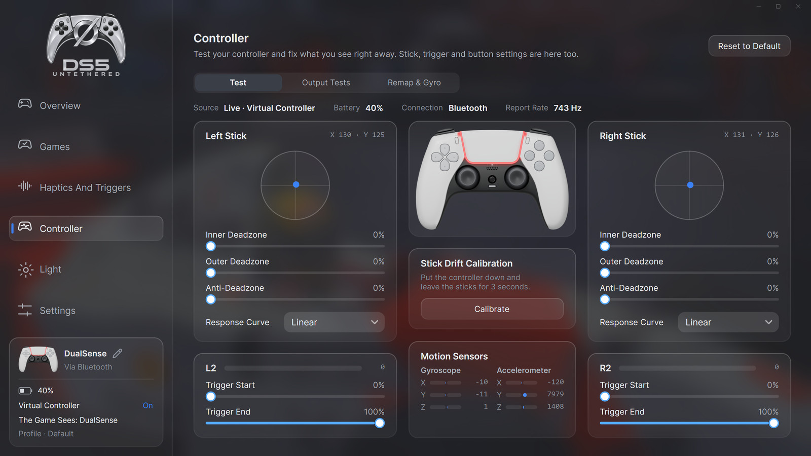 | 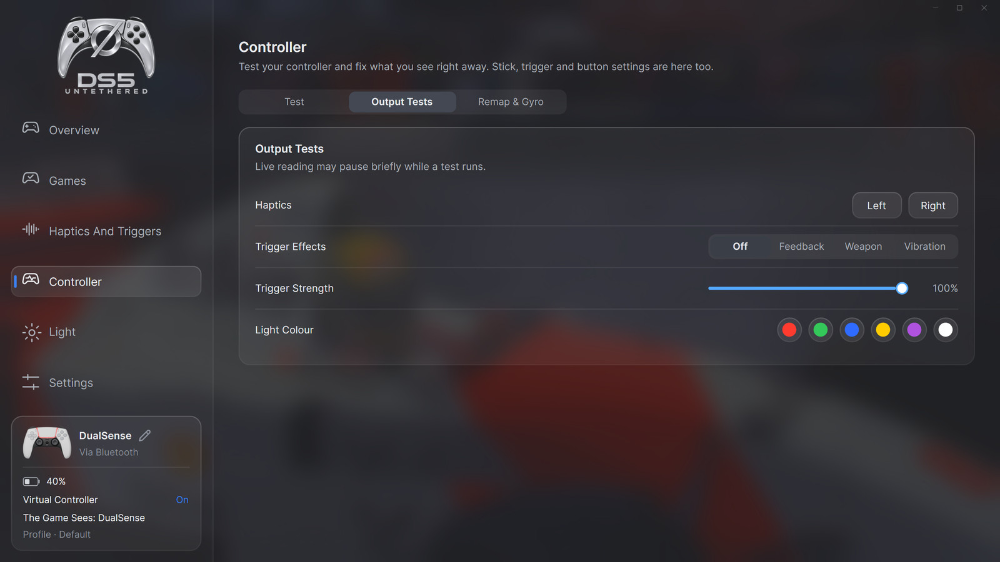 |
| 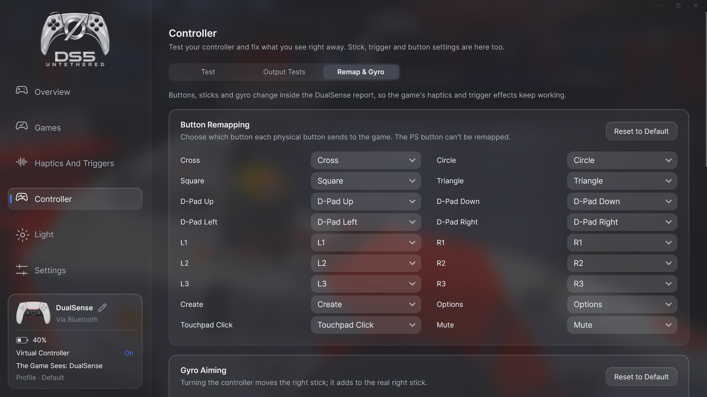 |  |
|  | 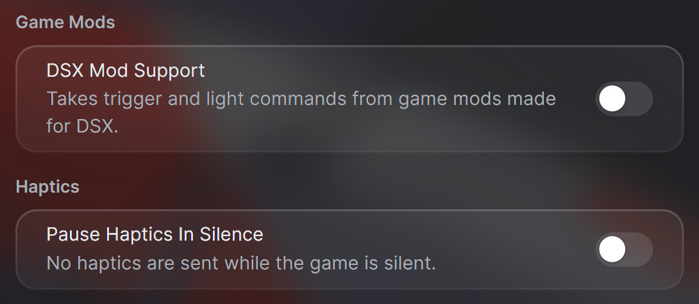 |
| 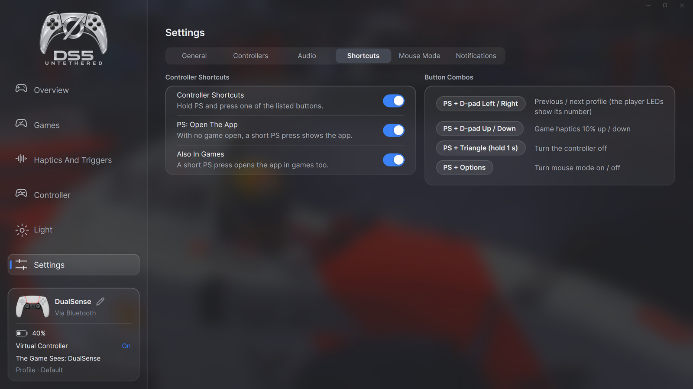 | 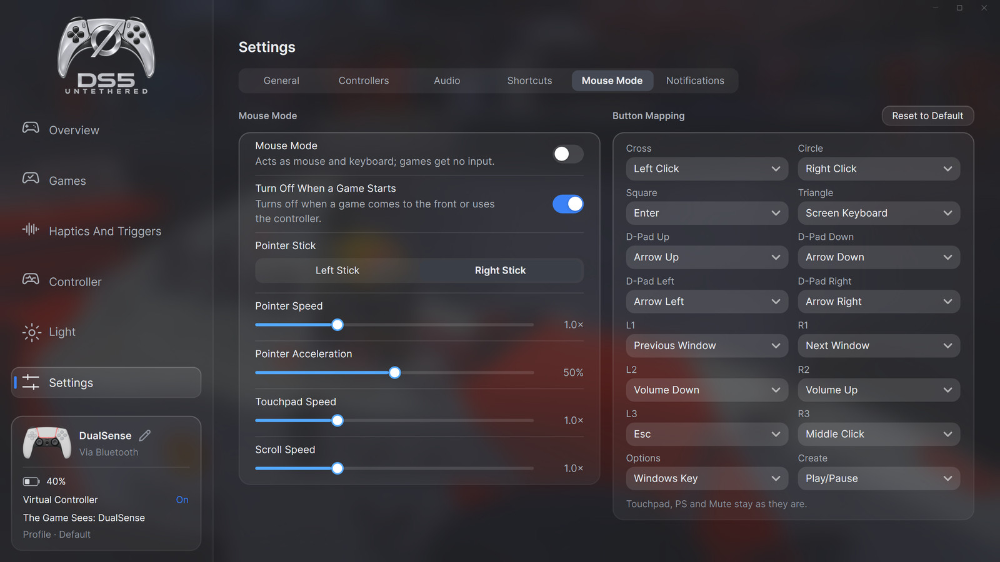 |
| 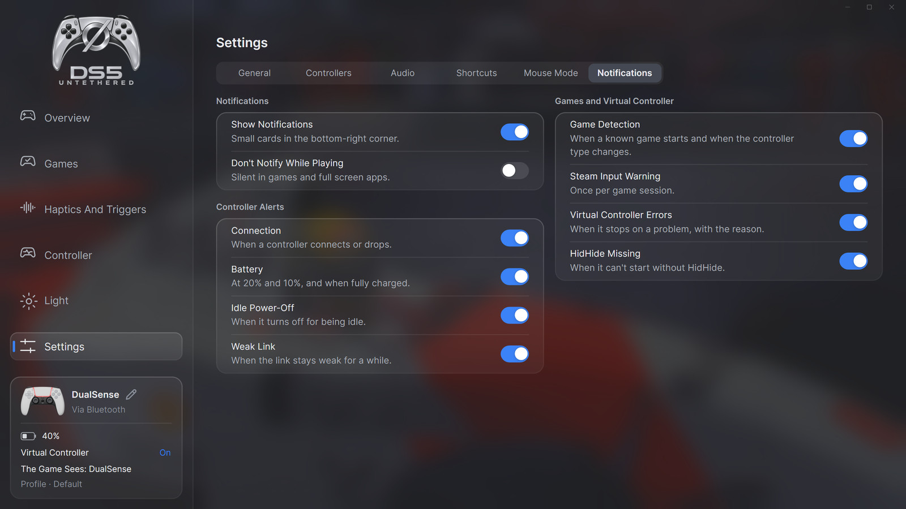 | |

### Disclaimer

DS5 Untethered is an unofficial project. It is not affiliated with, endorsed or sponsored by Sony Interactive Entertainment.
"DualSense", "DualSense Edge", "PlayStation" and "PS5" are trademarks of Sony Interactive Entertainment Inc. and are
used only to describe compatibility. "DS5" is used only as a common shorthand to describe compatibility. No Sony firmware, software, images or logos are included. The controller drawings
are original. The protocol implementation is an independent interoperability implementation based on public
documentation and our own measurements. Use at your own risk; the software comes with no warranty.

### License

GPL-3.0-or-later. See [LICENSE](LICENSE) and [THIRD-PARTY-NOTICES.md](THIRD-PARTY-NOTICES.md).

## Türkçe

DS5 Untethered, oyunun kendi haptiğini ve adaptif tetiklerini DualSense'te Bluetooth üzerinden çalıştırır.

### Hızlı Başlangıç

1. [Releases](https://github.com/Midzer00/ds5-untethered/releases/latest) sayfasından kurulum dosyasını
   (`DS5-Untethered-<sürüm>-Setup.exe`) indirip çalıştırın.
2. İki sürücüyü, [usbip-win2](https://github.com/vadimgrn/usbip-win2) ile [HidHide](https://github.com/nefarius/HidHide)'ı
   kurun. Kurulum programları yönetici izni ister.
3. Kumandayı Windows'ta Bluetooth'la eşleştirin.
4. DS5 Untethered'ı açıp kurulum sayfasındaki adımları izleyin: sayfa sürücülere bakar, eşleştirmede yol gösterir ve
   Bluetooth adaptörünü test eder.
5. Oyunu başlatın. Oyun kabloyla takılı bir DualSense görür, haptik ve tetik efektleri de Bluetooth'tan kumandaya ulaşır.

Sorunuz mu var? [Discussions](https://github.com/Midzer00/ds5-untethered/discussions) bölümüne yazın. Web sitesi: [midzer00.github.io/ds5-untethered/tr](https://midzer00.github.io/ds5-untethered/tr/).

### Sorun

PC'de DualSense'in oyun haptiği ve adaptif tetikleri yalnızca kumanda USB kabloyla bağlıyken çalışır. Bluetooth'la
bağlanınca oyunlar başka bir cihaz görür, bu özellikler de kaybolur. DS5 Untethered oyunlara kabloyla bağlı bir kumanda
gösterip bu özellikleri Bluetooth üzerinden kumandaya taşır.

### Nasıl çalışır

DS5 Untethered kumandaya Bluetooth'la bağlanıp yerel bir USB/IP sunucusu ve usbip-win2 üzerinden aynı bilgisayarda
kabloyla bağlı görünen sanal bir DualSense oluşturur. Oyunlar bu sanal kumandayı bilgisayara takılı sanıp onunla
haberleşir. Gerçek kumandadan gelen girdi sanal kumandaya aktarılırken oyunun gönderdiği çıktı (adaptif tetikler,
ışıklar) ve haptik sesi dönüştürülüp Bluetooth'la kumandaya geri yollanır. HidHide gerçek kumandayı oyunlardan
gizlediği için oyunlar yalnızca sanal kumandayı görür.

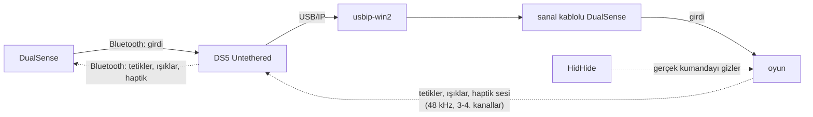

### İndirme

Güncel sürümü deponun [Releases](https://github.com/Midzer00/ds5-untethered/releases) sayfasından indirebilirsiniz.
Kurulum dosyası (`DS5-Untethered-<sürüm>-Setup.exe`) uygulamayı yalnızca sizin hesabınıza kurar ve yönetici izni
istemez. Zip'i (`DS5-Untethered-<sürüm>-win-x64.zip`) istediğiniz yere açıp `Kopru.App.exe`'yi çalıştırmanız yeterli.
.NET ikisinin de içinde olduğundan uygulama için başka bir şey kurmanız gerekmez.

- Derleme imzalı olmadığından Windows SmartScreen uyarı gösterebilir. "Ek bilgi"ye, ardından "Yine de çalıştır"a
  tıklayın.
- Kurulum sayfası, bir kez tamamlanana kadar uygulama her açıldığında karşınıza çıkar. Sayfa iki sürücünün, usbip-win2
  ile HidHide'ın kurulu olup olmadığına bakar ve resmi indirme sayfalarını açar (sürücüleri uygulama kurmaz, kurulum
  programları yönetici izni ister), sonra kumandayı Bluetooth'la eşleştirirken size yol gösterir. İki sürücü de
  kurulmadan sanal kumanda başlamaz.
- Ayarlar, profiller ve günlükler `%LOCALAPPDATA%\Untethered` klasöründe durur.
- Her sürümde neyin değiştiği [CHANGELOG.md](CHANGELOG.md) dosyasında.
- Ağ erişimi: "Oyun Görsellerini İndir" açıkken (Oyunlar sayfasındadır, baştan açık gelir) uygulama oyun
  görsellerini Steam'in herkese açık CDN'inden (yeni oyunlarda Steam'in herkese açık uygulama bilgilerinden de) indirir
  ve yalnızca `%LOCALAPPDATA%\Untethered\cache\game-images` klasöründe tutar. İsteklerle yalnızca oyunun Steam uygulama
  kimliği gönderilir, size ait hiçbir bilgi gitmez.
  Uygulama ayrıca açılışta ve haftada bir GitHub'da yeni sürüm var mı diye bakar (Ayarlar > Genel'deki "Güncellemeleri
  Otomatik Denetle" ile kapatılır); bu yalnızca bir dosya isteğidir, size ait hiçbir bilgi gitmez.
- Kaldırma: "Windows ile Başlat"ı kapatın, saat yanındaki simgeden uygulamadan çıkın, Windows Ayarlar →
  Uygulamalar'dan "DS5 Untethered"ı kaldırın (zip kullandıysanız klasörü silin). Ayarların da silinmesini istiyorsanız
  `%LOCALAPPDATA%\Untethered` klasörünü silin. Başka bir program kullanmıyorsa "USBip" ve "HidHide"ı da kaldırın.

### Sık sorulanlar

#### DualSense'in haptiği ve adaptif tetikleri PC'de Bluetooth'la çalışır mı?

Kendi başına çalışmaz, oyunlar bunları yalnızca kabloyla bağlı kumandaya yollar. DS5 Untethered açıkken oyun kabloyla
takılı bir DualSense görür, haptik ve tetik efektleri de Bluetooth'tan kumandaya ulaşır.

#### Dongle ya da ek donanım gerekiyor mu?

Özel bir donanım gerekmiyor. Bilgisayarın kendi Bluetooth'u ya da sıradan bir USB Bluetooth adaptörü yetiyor. Kurulum
sayfası adaptörü test ediyor.

#### Gecikme ekliyor mu?

Tek kumanda ve tek adaptörle yapılan 60 saniyelik testte girdi yaklaşık 750 Hz'de, düşük ek gecikmeyle ve kayıpsız
aktarıldı. Genel Bakış sayfası gecikmeyi canlı gösteriyor, kendi kurulumunuzda bakabilirsiniz.

#### Hangi oyunlarda çalışır?

DualSense'in haptiğini ya da adaptif tetiklerini USB kabloyla destekleyen oyunlarda. Bilinen oyunlar uygulamadaki
Oyunlar sayfasında, Desteklenen bölümünde listeleniyor. DualSense desteklemeyen oyunlarda Xbox ve DS4 Titreşimi
ayarları ya da Sesi Titreşime Çevir kullanılabilir.

#### Ücretli mi?

Hayır. Ücretsiz ve açık kaynak (GPL-3.0), ücretli sürümü yok.

DS5 Untethered ücretsiz ve ücretsiz kalacak. İşinize yaradıysa geliştirilmesine
[GitHub Sponsors](https://github.com/sponsors/Midzer00) üzerinden destek olabilirsiniz.

### Sorun Giderme

- **Kurulum sayfası usbip-win2 ya da HidHide kurulu değil diyor.** "usbip-win2'yi İndir" ya da "HidHide'ı İndir"e
  tıklayıp sürücüyü resmi sayfasından kurun, sonra "Yeniden Kontrol Et"e basın. Sayfada "Bilgisayarı Yeniden Başlat"
  çıkarsa sürücülerin çalışması için bilgisayarı yeniden başlatın.
- **Bluetooth adaptörü bulunamadı ya da Bluetooth kapalı.** "Bluetooth Ayarlarını Aç" ile Bluetooth'u açın. Sanal
  kumanda adaptör olmadan başlamaz; bilgisayarın kendi Bluetooth'u ya da sıradan bir USB adaptör yeter.
- **Bluetooth Adaptör Testi "Sınırda" ya da "Uygun değil" diyor.** Adaptörü öndeki bir USB 2.0 girişine ya da kısa bir
  USB uzatma kablosuyla masanın üstüne alın; USB 3.0 (mavi) girişlerden ve 2,4 GHz alıcılardan uzak tutun. Kumandayı
  birkaç metre içinde tutun; sonuç değişmezse Bluetooth 5 ya da daha yeni bir adaptör deneyin.
- **Kumanda Windows'ta eşleşmiş ama uygulama "Bağlı Değil" gösteriyor.** Kumanda kapalı ya da uykuda: PS tuşuna basın.
  Uygulama "Eşleşmemiş" gösteriyorsa Create ve PS tuşlarını ışık yanıp sönene kadar basılı tutup eşleştirin.
- **Kumanda USB kablosuyla takılı.** Oyunlar onu zaten kablolu gördüğü için uygulama sanal kumandayı durdurur ("Kablo
  Bağlandı"). Kablosuz oynamak için kabloyu çıkarın; sanal kumanda Bluetooth'ta kendiliğinden yeniden başlar.
- **Kurulum dosyasını açarken SmartScreen uyarı veriyor.** Derleme imzalı değil: "Ek bilgi"ye, ardından "Yine de
  çalıştır"a tıklayın.
- **Kumanda Türü değişince oyun kumandayı görmüyor.** Oyun açıkken yapılan değişiklik, oyunu yeniden başlatınca geçerli
  olur. "Şimdi Uygula" hemen geçirir ama oyun kumandayı kaybedebilir; o zaman oyunu yeniden başlatın.
- **Hata bildirirken.** Ayarlar ve profiller `%LOCALAPPDATA%\Untethered` klasöründe, günlükler de içindeki `logs`
  klasöründe durur. [Discussions](https://github.com/Midzer00/ds5-untethered/discussions) bölümüne yazarken günlüğü
  ekleyin.

### Ne durumda

Özelliklerin çoğu şimdilik yalnızca kod testlerinden geçti.

Tamamlandı, donanımda doğrulandı:
- Bluetooth oturumu: girdi okuma, çıktı raporları, haptik akışı; Bluetooth adaptör testi.
- usbip-win2 ile sanal kablolu DualSense: Windows kablolu DualSense olarak tanıyor, girdi uygulamalara ulaşıyor,
  oyun sesi geliyor.
- Köprü (60 saniyelik test): girdi yaklaşık 750 Hz'de, az ek gecikmeyle ve kayıpsız aktarıldı. Tetik ve ışık çıktısı
  iletildi, oyunun haptik sesi de Bluetooth haptik raporlarına dönüştürüldü.
- Bluetooth'ta mikrofon: Windows kumandanın mikrofonundan kayıt alıyor, sanal kumandada hayalet girdi oluşmuyor.
  Kumandadaki mikrofon tuşu mikrofonu açıp kapatıyor.
- Kumanda hoparlörü: kumandanın hoparlöründen çalınan sesi kumandanın kendi mikrofonu duyuyor.
- Fare Modu: dokunmatik yüzeyle imleç, her basışa tek tık, Sağ Tık ayarı (varsayılan Kapalı, Sağ Taraf ya da İki
  Parmak), uygulamayı açan kısa PS basışıyla açılması ve Oyuna Dön düğmesi.
- Bu deponun Releases sayfasından uygulama içi güncelleme (0.1.8 kendini 0.1.9'a güncelledi).
- DualShock 4 türü: kendini gerçek bir kablolu DualShock 4 gibi tanıtıyor; şimdilik DualShock 4'ü doğrudan destekleyen
  bir oyunda doğrulandı.

Tamamlandı ve kodda test edildi, donanımda henüz doğrulanmadı:
- Uygulama: kurulum sayfası, Genel Bakış, Oyunlar, Titreşim ve Tetikler, tek bir Kumanda sayfası (Test, Çıkış
  Testleri, Tuş Atama ve Gyro), Işık, Ayarlar, saat yanındaki simge ve bildirimler. Köprü arayüzde "Sanal Kumanda"
  adıyla görünür ve kendiliğinden başlar (Ayarlar > Genel'den ya da saat yanındaki simgenin menüsünden durdurulur).
  Kumanda görselleri kumandanın ışığını gerçek rengiyle gösterir.
- Oyun başına Kumanda Türü (DualSense, DualShock 4 ya da Xbox 360): DualSense destekleyen oyunların kendi haptiği ve
  tetikleri olduğu gibi geçer; Xbox ve DS4 Titreşimi ayarları yalnızca oyunun hiçbir şey göndermediği yerde devreye
  girer. Otomatik oyuna göre seçer: DualSense'i doğrudan destekleyen oyunlara DualSense (uygulamanın listesi,
  uygulamayla gelen Steam mağaza bilgisi ya da oyun oynanırken öğrenilir), yalnızca DualShock 4'ü destekleyenlere
  DualShock 4, diğerlerine Varsayılan Kumanda Türü, o da yoksa Xbox 360. Steam'in bilgisayardaki uygulama bilgilerini
  okur; oyunlarınızla ilgili hiçbir bilgi gönderilmez.
- Oyunlar sayfası: Steam ve Epic'ten bulunan Desteklenen ve Desteklenmeyen oyunlar, Oyna düğmesi, seçilebilen
  Başlatma Dosyası ve açılır pencerede her oyunun kendi ayarları. Oyunlar Steam verisindeki exe adlarından, Steam
  klasörleri dışına kuruluysa da tanınır.
- Gerçek kumandanın HidHide ile gizlenmesi; kendi haptiği olmayan oyunlarda titreşimin haptiğe çevrilmesi ve Sesi
  Titreşime Çevir; Sessizlikte Haptiği Durdur; yeniden bağlanma, pil uyarısı, boştayken kapanma.
- DSX Mod Desteği (varsayılan olarak kapalı): DSX için yapılmış oyun modları tetik ve ışık efektlerini gönderebilir.
- Tetik gücü, tuş atama, gyro ile nişan alma, ışık efektleri.
- Mikrofon tuşunun ışığı ve bildirimleri, oyunlarda kumanda hoparlörü.
- DualSense Edge; hatırlanan ve adlandırılabilen en çok dört kumanda.

Henüz yapılmadı:
- İki sürücünün kurulum programından kurulması, kod imzalama.
- Uzun oyun oturumları; yukarıdaki özelliklerin çoğunun gerçek donanımda denenmesi.

### Gereksinimler

- Windows 10 veya 11
- Bluetooth adaptörü
- [usbip-win2](https://github.com/vadimgrn/usbip-win2)
- [HidHide](https://github.com/nefarius/HidHide)

### Derleme

.NET 8 SDK gerekir. Deponun kök klasöründe şunları çalıştırın (`tools\test.ps1` derler, sonra test projelerini paralel süreçlerde çalıştırır; düz `dotnet test` de çalışır, yalnızca daha yavaştır):

```
dotnet build
powershell -ExecutionPolicy Bypass -File tools\test.ps1
```

### Ekran görüntüleri

| | |
|---|---|
| 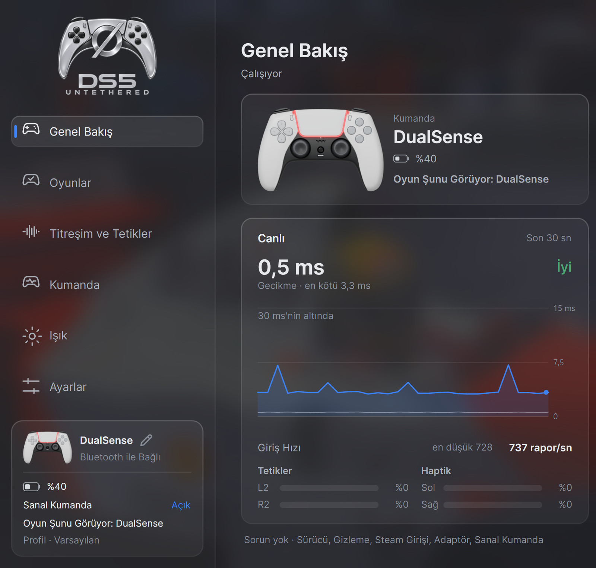 | 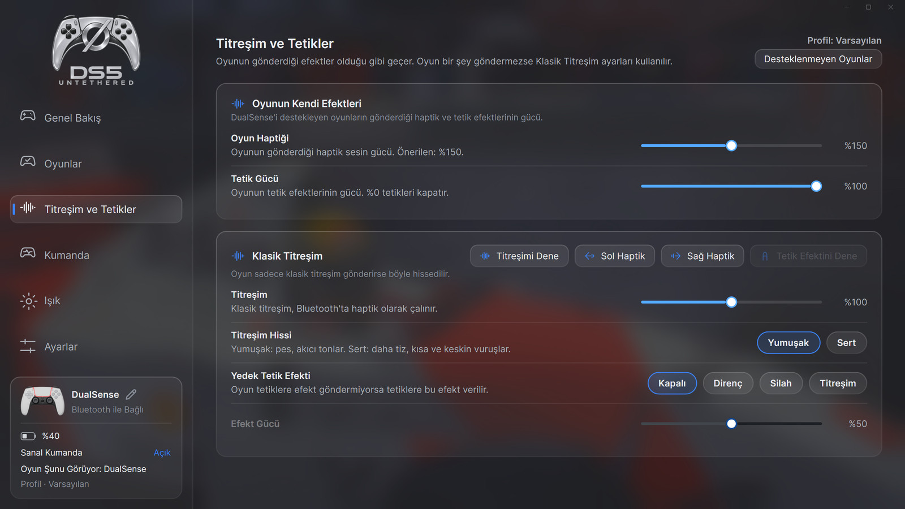 |
|  | 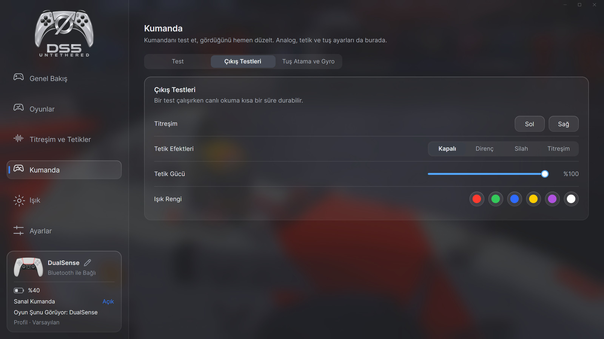 |
| 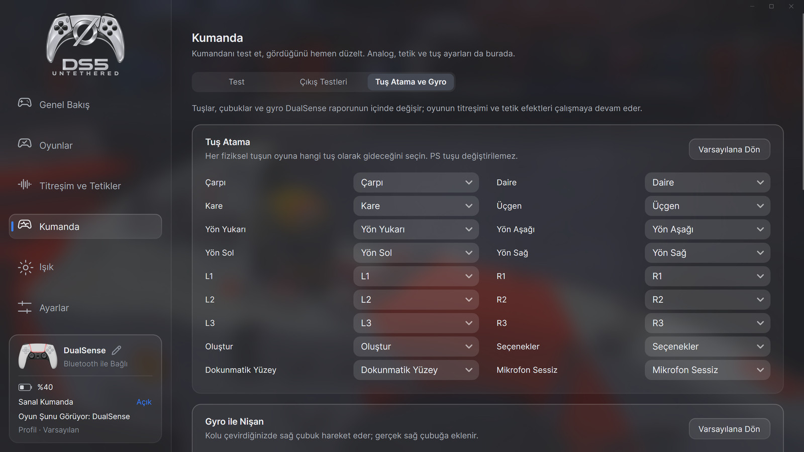 | 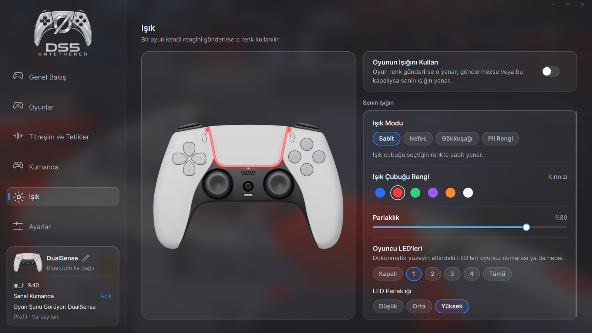 |
| 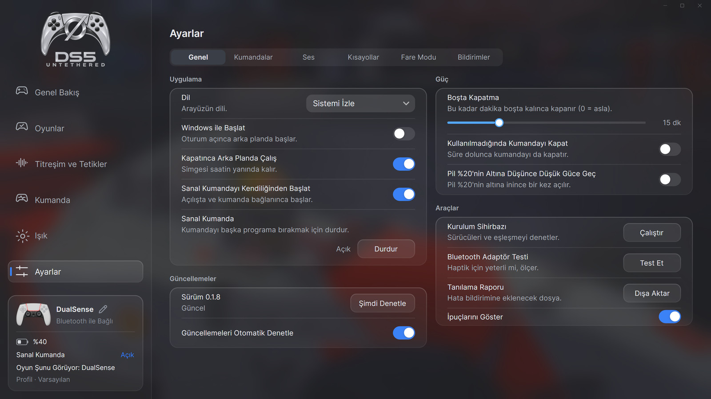 | 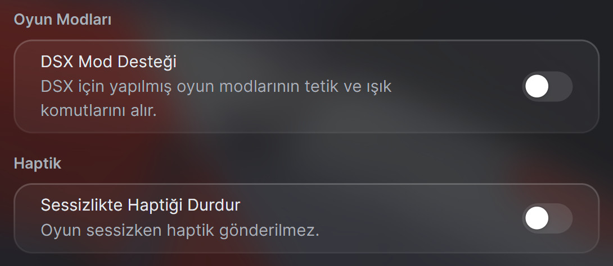 |
| 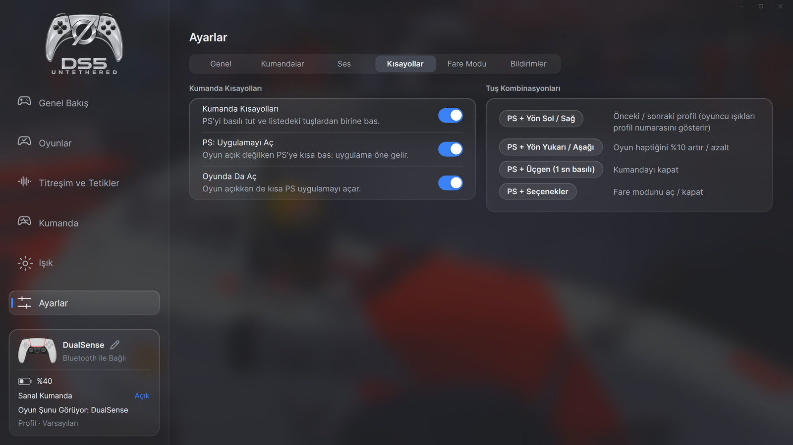 | 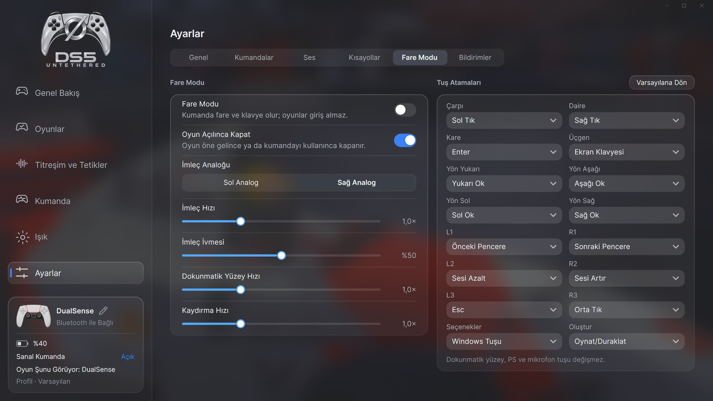 |
| 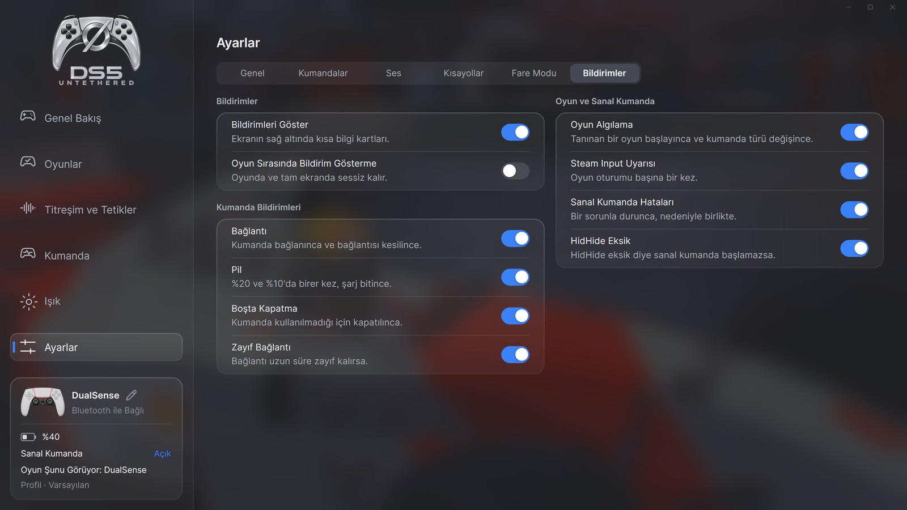 | |

### Yasal uyarı

DS5 Untethered resmi bir proje değildir. Sony Interactive Entertainment ile bağlantısı yoktur, şirketin onayını
ya da desteğini de almamıştır. "DualSense", "DualSense Edge", "PlayStation" ve "PS5",
Sony Interactive Entertainment Inc.'in ticari markalarıdır ve burada yalnızca uyumluluğu belirtmek için kullanılmıştır.
"DS5" de yalnızca uyumluluğu belirtmek için, yaygın bir kısaltma olarak kullanılmıştır. Projede Sony'ye ait hiçbir
donanım yazılımı, yazılım, görsel ya da logo yoktur. Kumanda çizimleri özgündür. Protokol, herkese açık belgelere ve
kendi ölçümlerimize dayanılarak, birlikte çalışabilirlik amacıyla bağımsız olarak uygulanmıştır. Yazılımın herhangi
bir garantisi yoktur. Kullanımdan doğabilecek her türlü sorumluluk size aittir.

### Lisans

GPL-3.0-or-later. Ayrıntılar [LICENSE](LICENSE) ve [THIRD-PARTY-NOTICES.md](THIRD-PARTY-NOTICES.md) dosyalarındadır.
