<p align="center"></p>

# DS5 Untethered

For DualSense — the game's own haptics and adaptive triggers over Bluetooth.

[English](#english) | [Türkçe](#türkçe)

## Disclaimer

DS5 Untethered is an unofficial project. It is not affiliated with, endorsed or sponsored by Sony Interactive Entertainment.
"DualSense", "DualSense Edge", "PlayStation" and "PS5" are trademarks of Sony Interactive Entertainment Inc. and are
used only to describe compatibility. "DS5" is used only as a common shorthand to describe compatibility. No Sony firmware, software, images or logos are included. The controller drawings
are original. The protocol implementation is an independent interoperability implementation based on public
documentation and our own measurements. Use at your own risk; the software comes with no warranty.

## English

### The problem

On a PC, a DualSense controller's game haptics and adaptive triggers only work when it is connected with a USB cable.
Over Bluetooth, games see a different device and these features are lost. DS5 Untethered relays them over Bluetooth so that
games see a wired controller.

### How it works

DS5 Untethered connects to the controller over Bluetooth and creates a virtual wired DualSense on the same PC through a local
USB/IP server and usbip-win2. Games talk to the virtual controller as if it were plugged in. Input from the real
controller is forwarded to the virtual one; the game's output (adaptive triggers, lights) and its haptics audio are
converted and sent back to the controller over Bluetooth. HidHide hides the real controller from games so they only
see the virtual one.

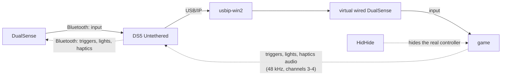

### Download

A preview build is on the repository's [Releases](https://github.com/Midzer00/ds5-untethered/releases) page, as an
installer (`DS5-Untethered-<version>-Setup.exe`, per-user, no administrator rights) and as a zip
(`DS5-Untethered-<version>-win-x64.zip`, unzip anywhere and run `Kopru.App.exe`). Both include .NET; nothing else needs
to be installed for the app itself.

- The build is not signed, so Windows SmartScreen may warn: choose "More info", then "Run anyway".
- On start, until it has been completed once, the Setup page checks for the two drivers, usbip-win2 and HidHide, and
  opens their official download pages (the app does not install them; their installers need administrator rights),
  then guides Bluetooth pairing of the controller. Both drivers are required: the virtual controller does not start
  without them.
- Settings, profiles and logs are stored in `%LOCALAPPDATA%\Untethered`.
- Network: with "Download Pictures" on (Supported Games page, on by default), the app fetches game header pictures
  from Steam's public CDN (and, for newer games, Steam's public app details) and keeps them only in
  `%LOCALAPPDATA%\Untethered\cache\game-images`. A request names only the game's Steam app id; nothing about you is sent.
- To uninstall: turn off "Start with Windows", exit the app from the tray icon, uninstall "DS5 Untethered" in Windows
  Settings → Apps (or delete the zip folder), and delete `%LOCALAPPDATA%\Untethered` if you want the settings gone.
  If nothing else uses them, uninstall "USBip" and "HidHide" too.

### Status

Preview. Most features are tested in code only; what was measured on a real controller is listed below.

Done and verified on hardware:
- Bluetooth session: input reading, output reports, haptics stream; Bluetooth adapter check.
- Virtual wired DualSense via usbip-win2: Windows recognizes it as a wired DualSense, input reaches applications,
  game audio arrives.
- Bridge (60 s test): input relayed at about 750 Hz with low added latency and no loss; trigger and light output
  forwarded; game haptics audio converted to Bluetooth haptics reports.
- Bluetooth microphone: Windows records from the controller's microphone, with no ghost input on the virtual
  controller; the controller's mute button turns the microphone on and off.
- Controller speaker: sound played to the controller's speaker is heard by its own microphone.

Done and tested in code, not yet verified on hardware:
- The app: setup page, Overview, one Controller page (Test, Triggers, Remap and Gyro), Light, Supported Games,
  Settings, tray icon and notifications; the bridge is shown as the "Virtual Controller" and starts by itself
  (stop it in Settings > General or from the menu of its icon next to the clock).
- Hiding the real controller with HidHide; rumble to haptics for games without native haptics; reconnection,
  battery warning, idle power-off.
- Profiles per game, trigger strength, remapping, gyro aim, light effects, mouse mode.
- Microphone button light and notifications, controller speaker in games.
- DualSense Edge, up to four controllers that are remembered and can be named, Xbox 360 or DualShock 4 emulation per
  game.

Not done yet:
- Installing the two drivers from the installer, code signing, update check.
- Long gaming sessions and most features above on real hardware.

### Requirements

- Windows 10 or 11
- A Bluetooth adapter
- [usbip-win2](https://github.com/vadimgrn/usbip-win2)
- [HidHide](https://github.com/nefarius/HidHide)

### Building

Requires the .NET 8 SDK. From the repository root:

```
dotnet build
dotnet test
```

### Screenshots

| | |
|---|---|
| 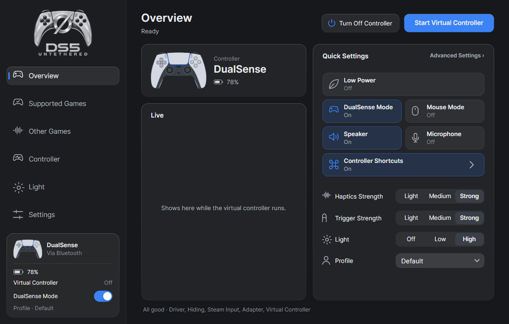 | 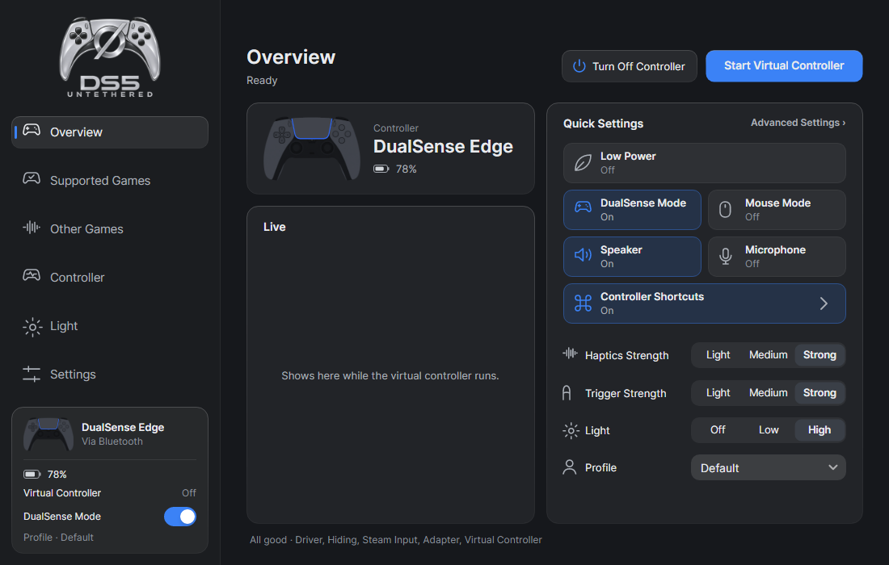 |
| 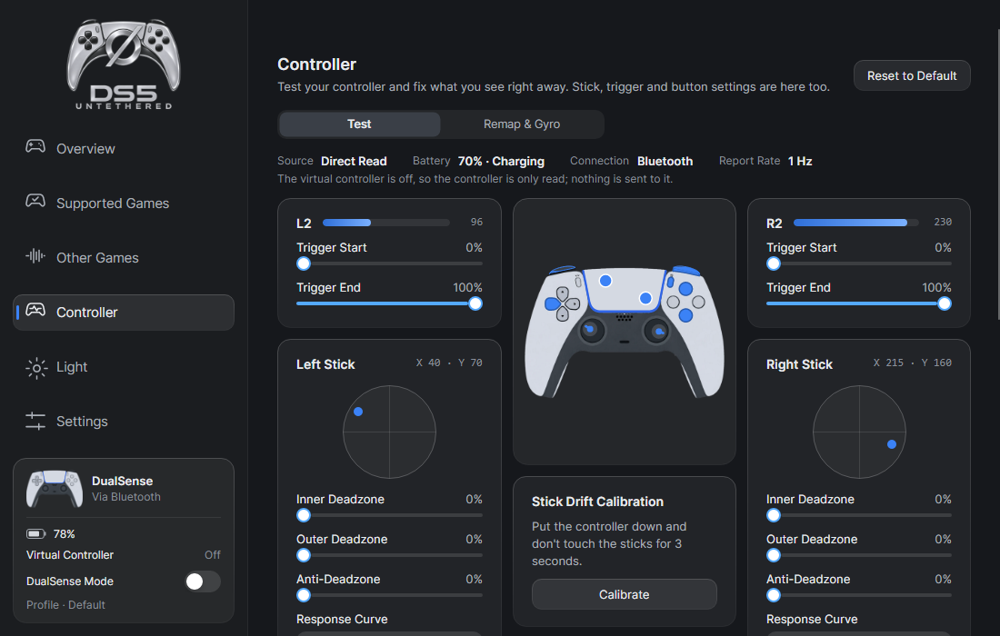 | 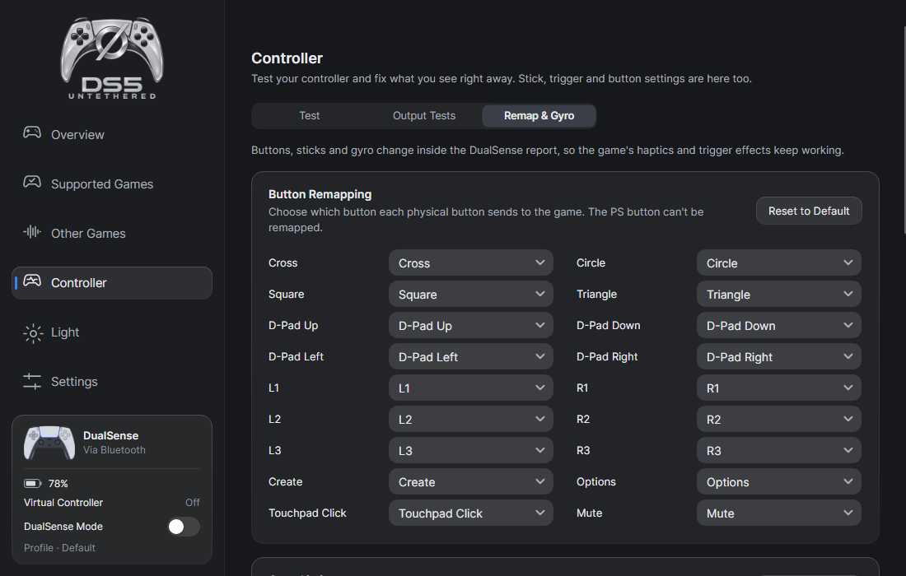 |
| 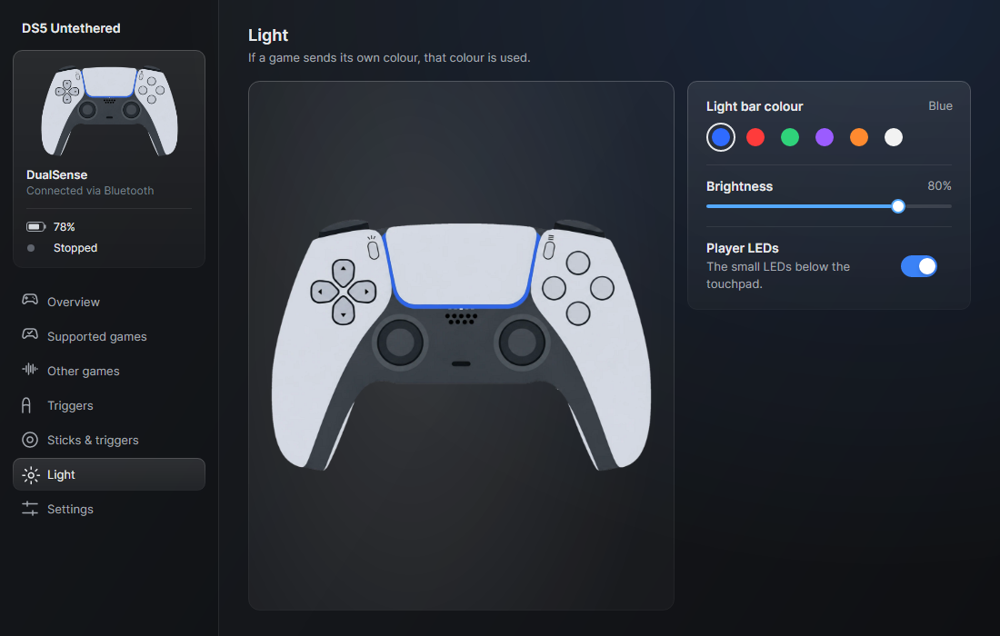 | 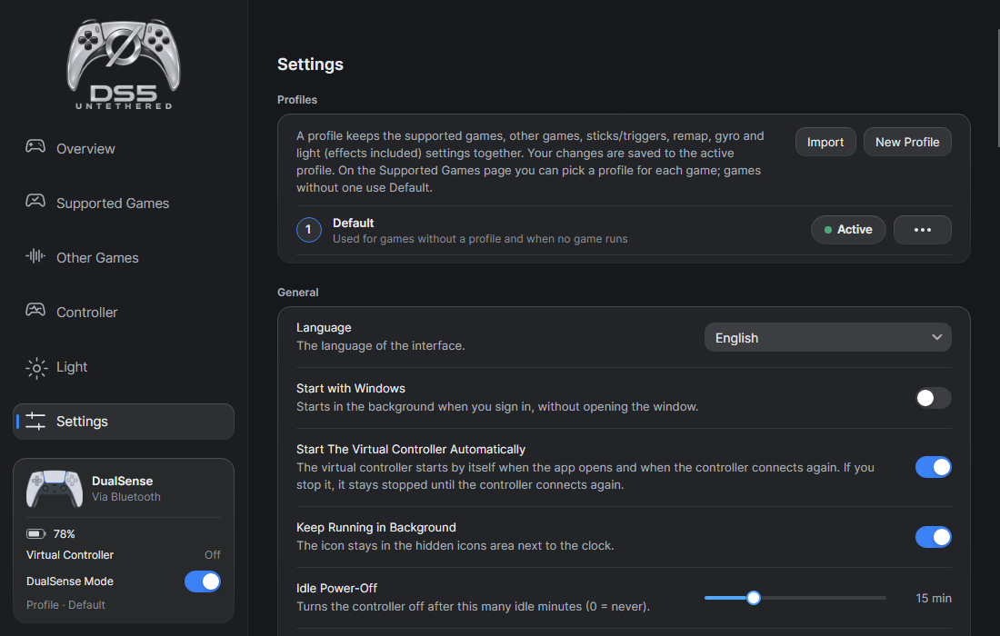 |

### License

GPL-3.0-or-later. See [LICENSE](LICENSE) and [THIRD-PARTY-NOTICES.md](THIRD-PARTY-NOTICES.md).

## Türkçe

Oyunun kendi haptiğini ve adaptif tetiklerini DualSense'te Bluetooth üzerinden çalıştırır.

### Feragat

DS5 Untethered resmi bir proje değildir. Sony Interactive Entertainment ile bağlantısı yoktur; Sony Interactive
Entertainment bu projeyi onaylamamış ve desteklememiştir. "DualSense", "DualSense Edge", "PlayStation" ve "PS5",
Sony Interactive Entertainment Inc.'in ticari markalarıdır ve burada yalnızca uyumluluğu belirtmek için kullanılmıştır.
"DS5" de yalnızca uyumluluğu belirtmek için, yaygın bir kısaltma olarak kullanılmıştır. Projede Sony'ye ait hiçbir
donanım yazılımı, yazılım, görsel ya da logo yoktur. Kumanda çizimleri özgündür. Protokol, herkese açık belgelere ve
kendi ölçümlerimize dayanılarak, birlikte çalışabilirlik amacıyla bağımsız olarak uygulanmıştır. Kullanımdan doğan
risk size aittir; yazılım için hiçbir garanti verilmez.

### Sorun

PC'de DualSense'in oyun haptiği ve adaptif tetikleri yalnızca kumanda USB kabloyla bağlıyken çalışır. Bluetooth'la
bağlanınca oyunlar başka bir cihaz görür, bu özellikler de kaybolur. DS5 Untethered bu özellikleri Bluetooth üzerinden
kumandaya taşır; oyunlar kabloyla bağlı bir kumanda görür.

### Nasıl çalışır

DS5 Untethered kumandaya Bluetooth'la bağlanır; yerel bir USB/IP sunucusu ve usbip-win2 üzerinden aynı bilgisayarda
kabloyla bağlı görünen sanal bir DualSense oluşturur. Oyunlar bu sanal kumandayı bilgisayara takılı sanıp onunla
haberleşir. Gerçek kumandadan gelen girdi sanal kumandaya aktarılır; oyunun gönderdiği çıktı (adaptif tetikler,
ışıklar) ve haptik sesi dönüştürülüp Bluetooth'la kumandaya geri yollanır. HidHide gerçek kumandayı oyunlardan
gizlediği için oyunlar yalnızca sanal kumandayı görür.

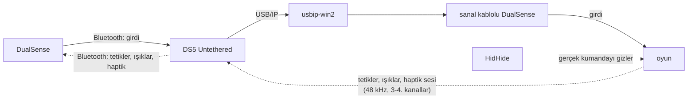

### İndirme

Ön sürümü deponun [Releases](https://github.com/Midzer00/ds5-untethered/releases) sayfasından indirebilirsiniz. İki
biçimde gelir: kurulum dosyası (`DS5-Untethered-<sürüm>-Setup.exe`; yalnızca geçerli kullanıcıya kurar, yönetici izni
istemez) ve zip (`DS5-Untethered-<sürüm>-win-x64.zip`; istediğiniz yere açıp `Kopru.App.exe` dosyasını çalıştırırsınız).
.NET ikisinin de içindedir; uygulama için başka bir şey kurmanız gerekmez.

- Derleme imzalı olmadığından Windows SmartScreen uyarı gösterebilir. "Ek bilgi"ye, ardından "Yine de çalıştır"a
  tıklayın.
- Kurulum sayfası, bir kez tamamlanana kadar uygulama her açıldığında karşınıza çıkar. Sayfa iki sürücünün, usbip-win2
  ile HidHide'ın kurulu olup olmadığına bakar ve resmi indirme sayfalarını açar (sürücüleri uygulama kurmaz; kurulum
  programları yönetici izni ister), sonra kumandayı Bluetooth'la eşleştirirken size yol gösterir. İki sürücü de
  şarttır; sürücüler olmadan sanal kumanda başlamaz.
- Ayarlar, profiller ve günlükler `%LOCALAPPDATA%\Untethered` klasöründe durur.
- Ağ erişimi: "Oyun Görsellerini İndir" açıkken (Desteklenen Oyunlar sayfasındadır, baştan açık gelir) uygulama oyun
  görsellerini Steam'in herkese açık CDN'inden (yeni oyunlarda Steam'in herkese açık uygulama bilgilerinden de) indirir
  ve yalnızca `%LOCALAPPDATA%\Untethered\cache\game-images` klasöründe tutar. İsteklerde yalnızca oyunun Steam uygulama
  kimliği yer alır; size ait hiçbir bilgi gönderilmez.
- Kaldırma: "Windows ile Başlat"ı kapatın, saat yanındaki simgeden uygulamadan çıkın, Windows Ayarlar →
  Uygulamalar'dan "DS5 Untethered"ı kaldırın (zip kullandıysanız klasörü silin). Ayarların da silinmesini istiyorsanız
  `%LOCALAPPDATA%\Untethered` klasörünü silin. Başka bir program kullanmıyorsa "USBip" ve "HidHide"ı da kaldırın.

### Durum

Ön sürüm. Özelliklerin çoğu yalnızca kod testlerinden geçti; gerçek kumandada ölçülenler aşağıda listelenmiştir.

Tamamlandı, donanımda doğrulandı:
- Bluetooth oturumu: girdi okuma, çıktı raporları, haptik akışı; Bluetooth adaptör testi.
- usbip-win2 ile sanal kablolu DualSense: Windows kablolu DualSense olarak tanıyor, girdi uygulamalara ulaşıyor,
  oyun sesi geliyor.
- Köprü (60 saniyelik test): girdi yaklaşık 750 Hz'de, az ek gecikmeyle ve kayıpsız aktarıldı; tetik ve ışık çıktısı
  iletildi; oyunun haptik sesi Bluetooth haptik raporlarına dönüştürüldü.
- Bluetooth'ta mikrofon: Windows kumandanın mikrofonundan kayıt alıyor, sanal kumandada hayalet girdi oluşmuyor;
  kumandadaki mikrofon tuşu mikrofonu açıp kapatıyor.
- Kumanda hoparlörü: kumandanın hoparlöründen çalınan sesi kumandanın kendi mikrofonu duyuyor.

Tamamlandı ve kodda test edildi, donanımda henüz doğrulanmadı:
- Uygulama: kurulum sayfası, Genel Bakış, tek bir Kumanda sayfası (Test, Çıkış Testleri, Tuş Atama ve Gyro), Işık,
  Desteklenen Oyunlar, Ayarlar, saat yanındaki simge ve bildirimler. Köprü arayüzde "Sanal Kumanda" adıyla görünür ve
  kendiliğinden başlar (Ayarlar > Genel'den ya da saat yanındaki simgenin menüsünden durdurulur).
- Gerçek kumandanın HidHide ile gizlenmesi; kendi haptiği olmayan oyunlarda titreşimin haptiğe çevrilmesi; yeniden
  bağlanma, pil uyarısı, boştayken kapanma.
- Oyuna özel profiller, tetik gücü, tuş atama, gyro ile nişan alma, ışık efektleri, fare modu.
- Mikrofon tuşunun ışığı ve bildirimleri, oyunlarda kumanda hoparlörü.
- DualSense Edge; hatırlanan ve adlandırılabilen en çok dört kumanda; oyuna göre Xbox 360 ya da DualShock 4 taklidi.

Henüz yapılmadı:
- İki sürücünün kurulum programından kurulması, kod imzalama, güncelleme denetimi.
- Uzun oyun oturumları; yukarıdaki özelliklerin çoğunun gerçek donanımda denenmesi.

### Gereksinimler

- Windows 10 veya 11
- Bluetooth adaptörü
- [usbip-win2](https://github.com/vadimgrn/usbip-win2)
- [HidHide](https://github.com/nefarius/HidHide)

### Derleme

.NET 8 SDK gerekir. Deponun kök klasöründe şunları çalıştırın:

```
dotnet build
dotnet test
```

### Ekran görüntüleri

| | |
|---|---|
| 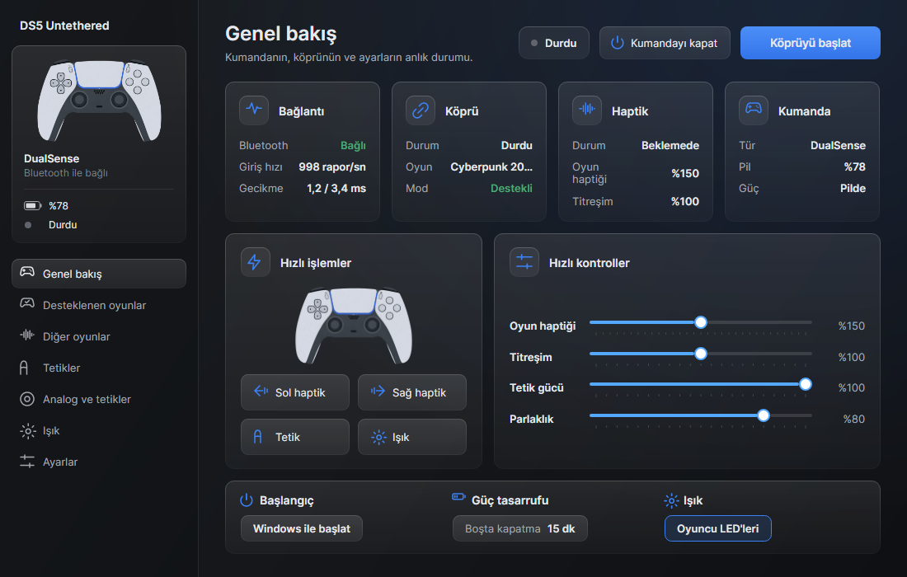 | 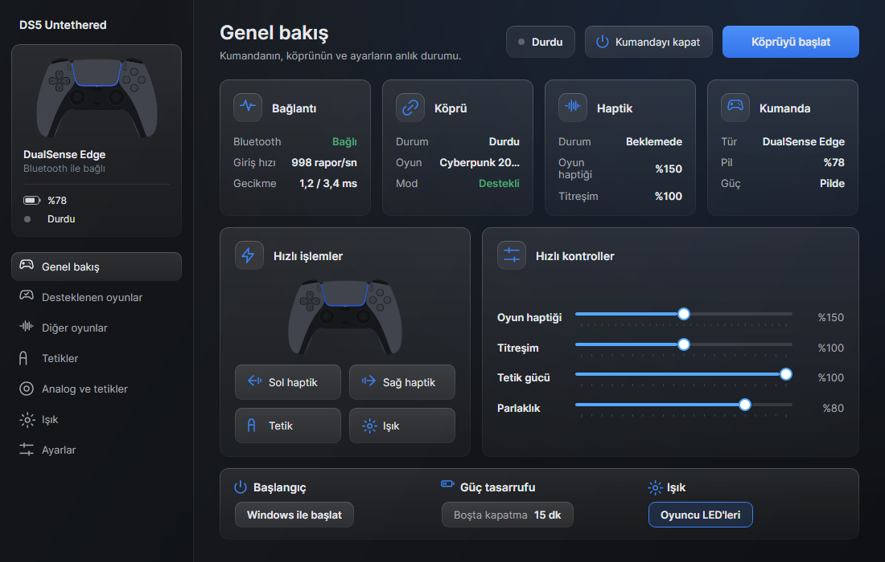 |
| 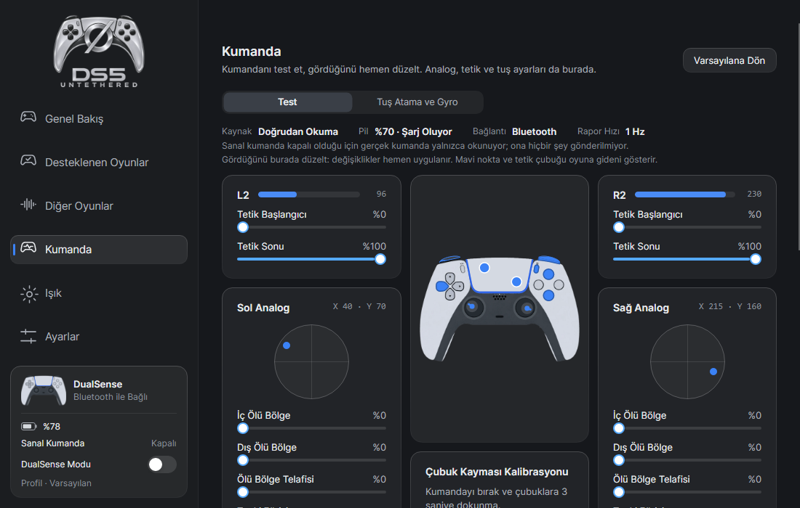 | 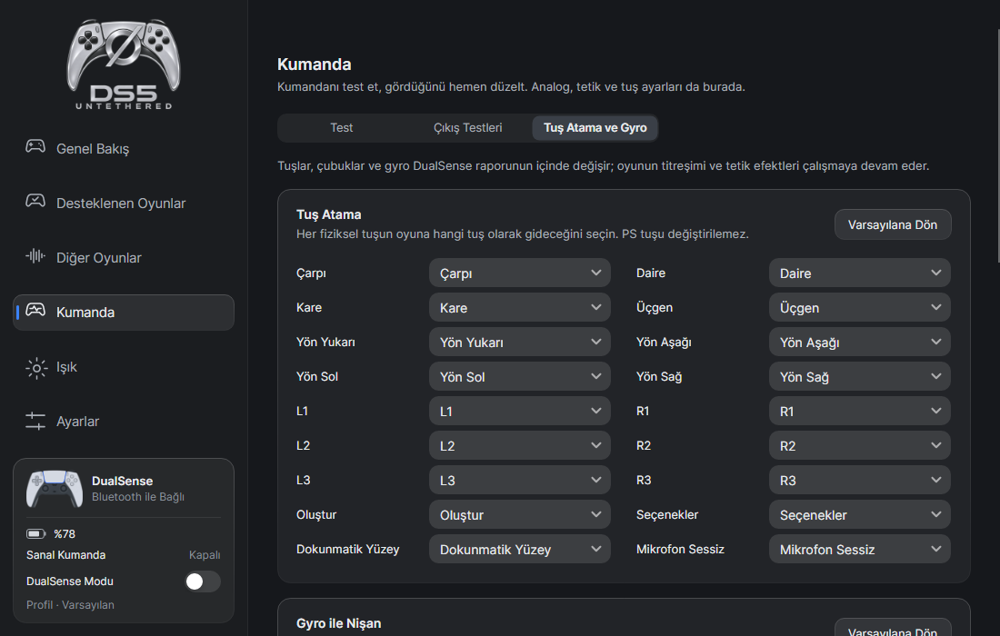 |
| 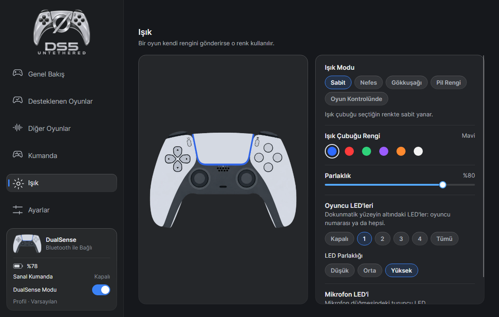 | 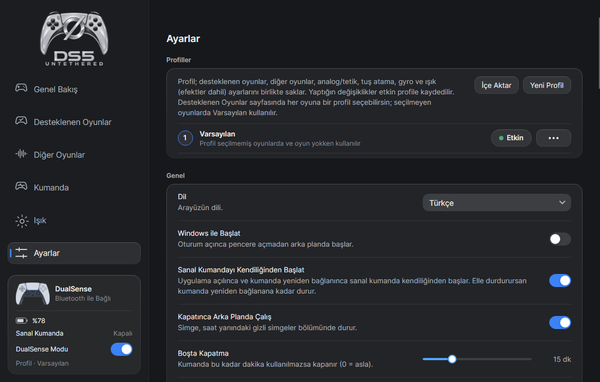 |

### Lisans

GPL-3.0-or-later. Ayrıntılar [LICENSE](LICENSE) ve [THIRD-PARTY-NOTICES.md](THIRD-PARTY-NOTICES.md) dosyalarındadır.
